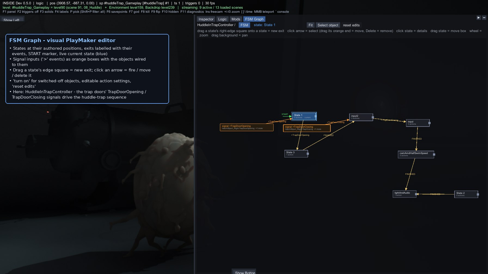
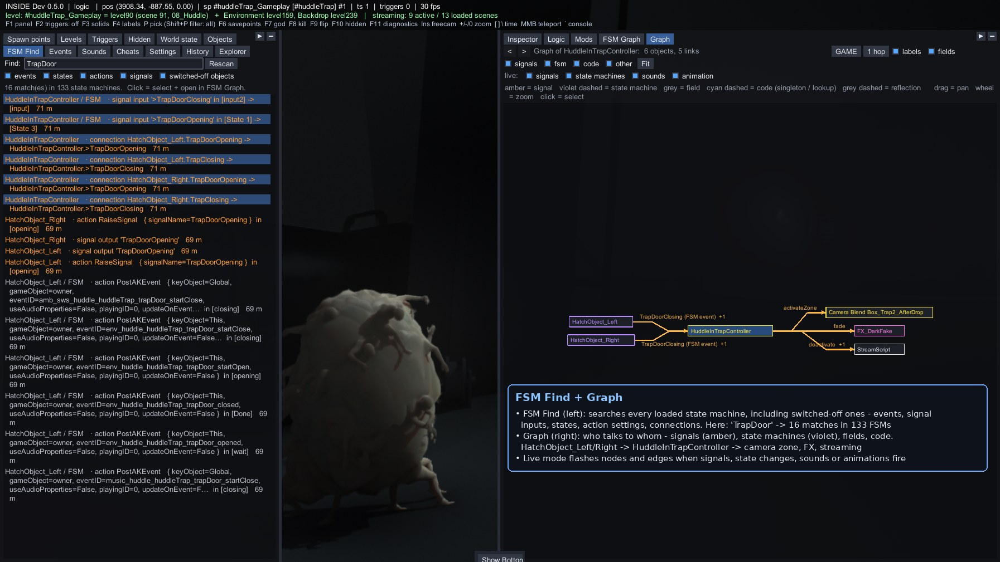
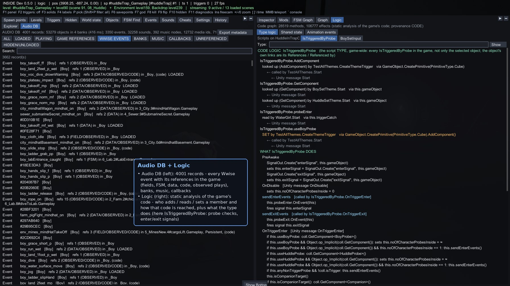
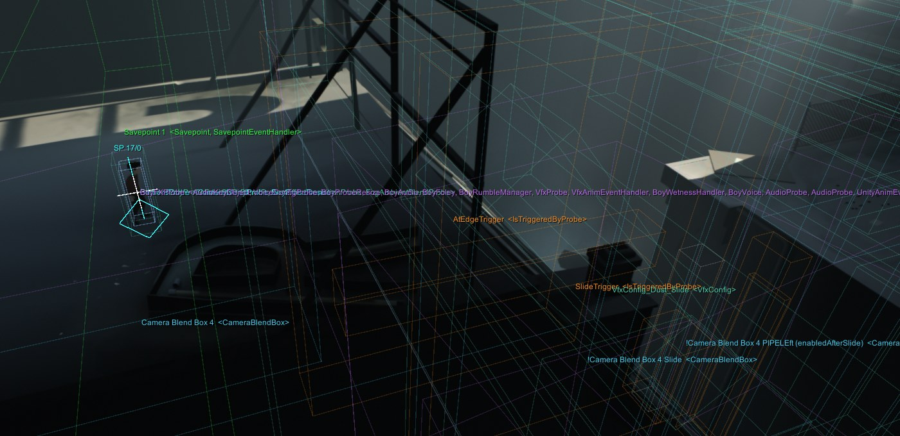
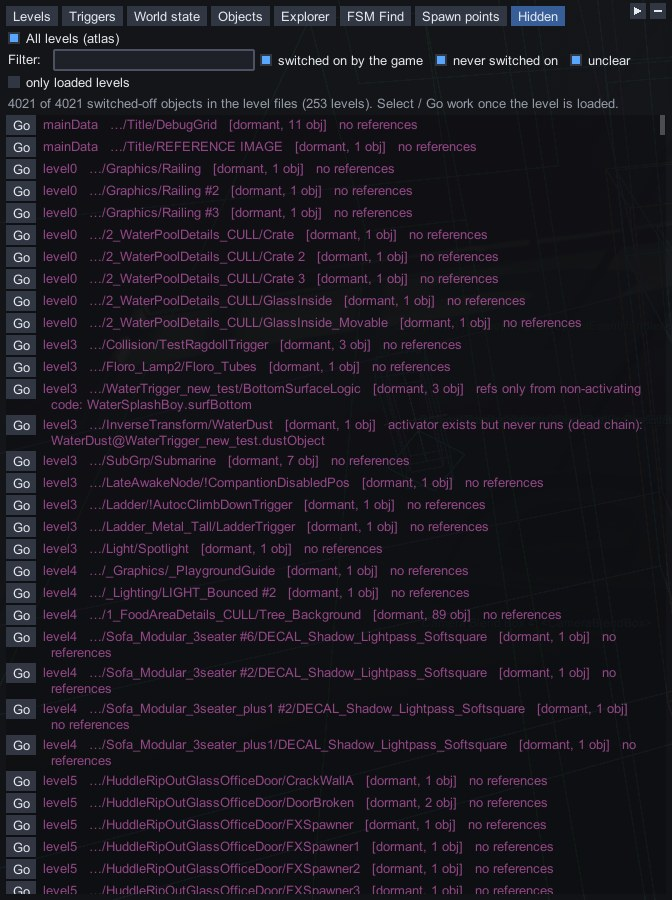
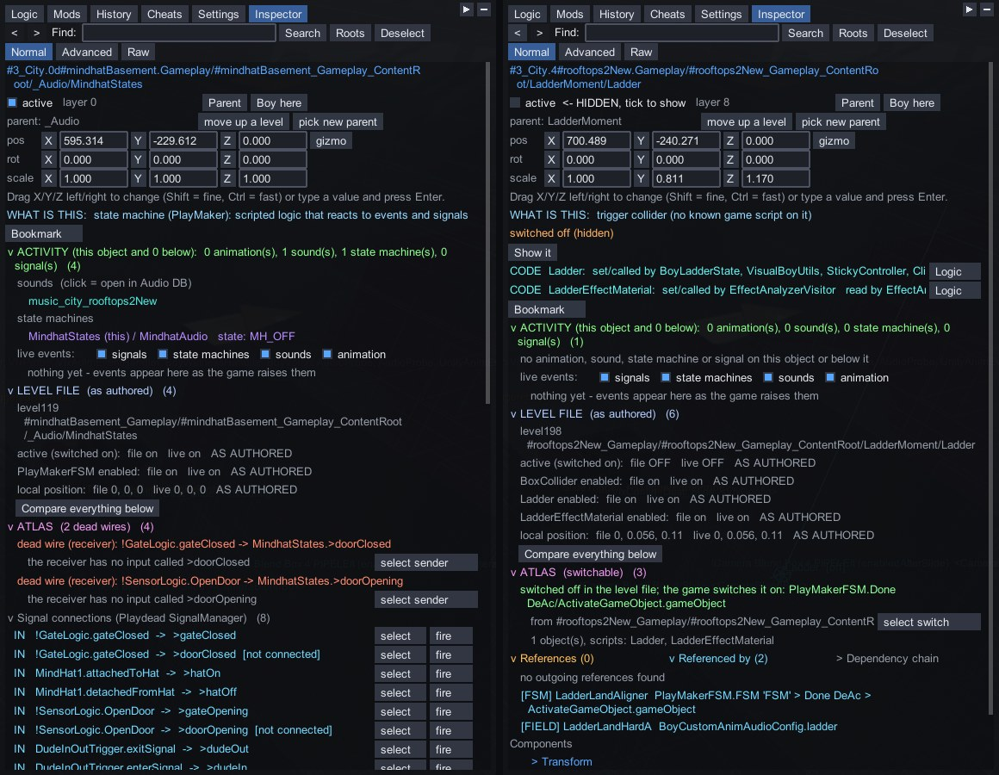
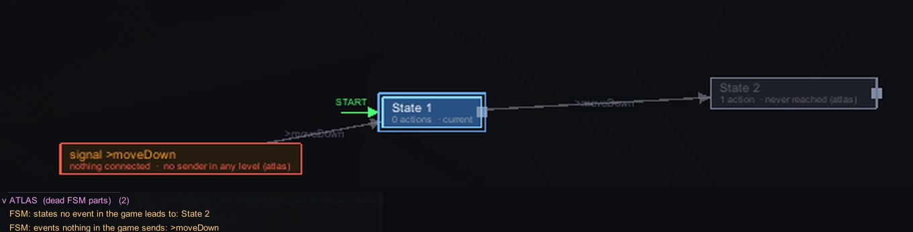
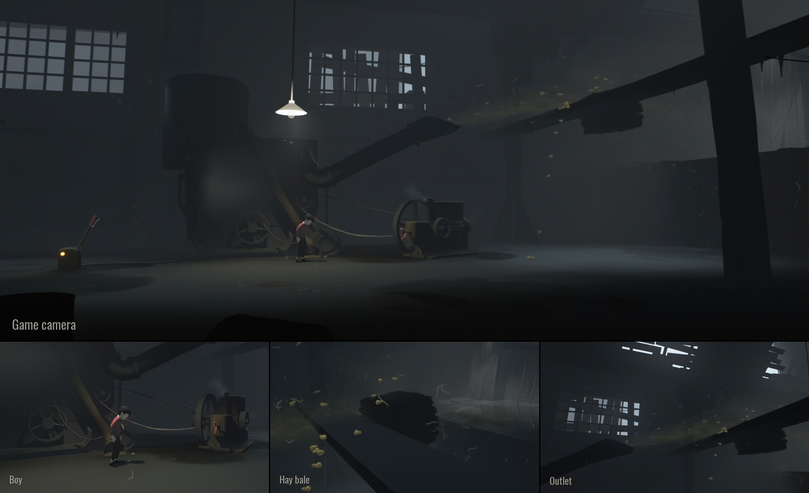
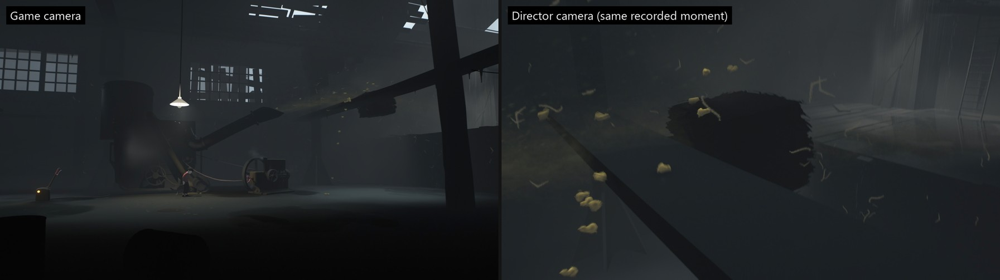

# INSIDE runtime editor (InsideDev 0.11.0)

An in-game editor and explorer for Playdead's INSIDE (Unity 5.0.4f1): browse and edit the live scene, see how
objects, signals, PlayMaker state machines, code and audio are connected, record changes as mods, and inspect memory
with Cheat Engine.

> Unofficial fan-made tool, not affiliated with or endorsed by Playdead. INSIDE is a trademark of Playdead.
> This repository contains no game files or game code; you need your own copy of the game.

## What is new in 0.11.0: costs nothing while unused, recordings that keep game time, a closed server

0.11.0 is a review of every part of InsideDev, line by line. Existing commands, MCP tools, config keys and file formats
keep working. Where a default changed, the table below names the setting that brings the old behaviour back. The full
text of each item is in the [0.11.0 release notes](https://github.com/RedMatterGG/InsideDevTool/releases/tag/v0.11.0);
every command, setting and MCP tool argument is listed in [docs/COMMANDS.md](docs/COMMANDS.md), which is generated from
the code.

- **Speed** (release notes: "Speed"). With the editor closed and no client connected, every scanner and monitor sleeps
  until a panel, a command or a client needs it: 0.03 ms per frame and no garbage collection in 95 s, against 1.2 to
  2.8 ms and 17 to 23 collections a minute for 0.10.0 in the same scene. `background always` brings the old always-on
  behaviour back. Mods are looked up and applied only while their own level is loaded (`mod list` shows each mod's
  levels and cost). An MCP screenshot at 960 px takes 0.09 s instead of 2.25 s, `observe` 8 ms instead of 33 ms, a
  command through `POST /cmd` 8 ms instead of 18 ms.
- **Recording you can trust** (release notes: "Recording you can trust"). `grec` places frames by game time: a 120 s
  recording under load gave 120.13 s of video for 120.10 s of game time, and `<file>.times.csv` gives each frame's game
  time for audio alignment. `time {op:"record"}` and `rec start` record the game's own frames, so a window over the game
  stays out of the video. A folder that already holds a take is not overwritten without `overwrite=on`. Steps:
  [docs/PLAY.md](docs/PLAY.md) sections 4.5 and 4.6.
- **Security** (release notes: "Security", and [Security](#security) below). Web pages can no longer send commands to the
  game, no MCP call can name a program to start, `reflect` works on an allow list, and the Mono debugger port stays off
  unless you create a flag file.
- **One self-check, one reference** (release notes: "New commands and tools"). `doctor` checks every part (loader,
  modules and their versions, ffmpeg and encoders, disk, window, time scale, background mode) and says how to fix what
  fails. `help` lists every command and `help <command>` prints the usage of one. `cfg` lists every setting with its
  value, default and meaning and changes it while the game runs. Every bridge command now also works in the in-game
  console, and the status commands have a `json` form.
- **For agents and scripts** (release notes: "New commands and tools"). `GET /status`, `POST /cmds` (several commands in one
  request), `POST /cmd?wait=...`, the `film` MCP tool (panorama, game video, director camera), `observe {detail:"delta"}`,
  `act {seq:"R1.2 J R0.4+J"}`, `wait_ready_s` on the action tools, `checkpoint {op:"goto", name}`,
  `restore {dry_run:true}`, `inside_ctl.py wait`, `snapshot` and `doctor`. References: [docs/MCP.md](docs/MCP.md),
  [docs/PLAY.md](docs/PLAY.md), [docs/TOOLS.md](docs/TOOLS.md).
- **Fixed** (release notes: "Fixed"). Among others: a mod file with a JSON error is no longer emptied when you tick it;
  the file bridge no longer answers with empty text after 400 log lines; numbers use a decimal point on every Windows
  language; the stdio launcher keeps `inside_status` in its tool list; `move_to` no longer jumps a gap back and forth when
  its goal lies inside the gap.

Upgrading from 0.10.0: close the game, replace `version.dll`, the DLLs in `<game>\_mod\`, `InsideReadback.dll` in
`<game>\INSIDE_Data\Plugins\`, the stdio launcher and InsideMuter, then start the game and run `doctor`. Extension
modules built against 0.10.0 load unchanged (tested with three).

### Changed defaults

| What | 0.10.0 | 0.11.0 | Old behaviour back |
|---|---|---|---|
| Background scanners (object database, audio log, event monitor, Wwise trace, audio catalogue) | always on | only while the tool is used: a panel is open, or a command or client call came in the last 30 s | `background=always` in `editor.cfg`, or the command `background always` |
| Passive scanner for hidden objects | on | off; runs while the Hidden tab is drawn and for `hidden scan [seconds]` | `hidden on` (saved as `hidden.passive=1`) |
| `_mod\cmd\state.txt` of the file bridge | rewritten every 5 s | only while command files arrive | `bridge.state=always` |
| Recording into a folder that already holds a take (`srec record start`, `mcam start / take / record`, `det run`) | overwritten | refused | `overwrite=on` |
| Mono debugger port 55555 | on | off | create `<game>\_mod\debugger.flag` |
| Requests with a foreign or `null` Origin, a foreign Host, or `Sec-Fetch-Site: cross-site` | accepted | refused (HTTP 403) | none: use a local client; `mcp hosts <name>` adds Host names |
| `time {op:"record"}` / `rec start` source | desktop | the game's own frames (needs `InsideReadback.dll`) | `source:"desktop"` / `rec start ... desktop` |
| vSync with Play installed (`play.vsync_off=1`) | off from game start | off only while an agent's calls arrive or the clock is held | `play.vsync_off=2` |
| InsideMuter on exit | leaves the sessions muted | un-mutes the sessions it muted | `--keep-muted` |
| `reflect` calls and writes | deny list | allow list | none |
| World labels | every component | 3 names and "+N" | `labels types all` (saved as `overlay.label.types=-1`) |
| `grec` / `pano` file given as a bare name | the game's working folder | `<game>\_mod\recordings\` | give a full path |

## What's new in 0.10.0: a 360 degree panorama command, a much cheaper muter, less garbage per frame

Everything new runs only when you call it, and the game sound is still never muted unless you start InsideMuter yourself. One
built-in limit changed for everyone: a detached MCP job may now run 45 minutes instead of 10 (below).

- **360 degree panorama (`pano`, with Play).** One console command writes an equirectangular PNG that panorama viewers open
  directly, with a JSON file that says where the eye was. Each of the six cube faces is an ordinary game frame, so the picture
  is what a screenshot would show there: fog, water, the game's post chain and everything the game streams in for the
  camera. A 4096x2048 panorama took 2.3 to 2.7 s in all, of which the picture jumps around for 0.2 to 1 s (13 frames at a 2560x1440
  game view), tried at places along a long bunker route in a mod scene. Steps: [docs/PLAY.md](docs/PLAY.md) section 4.7.
- **Limits for a first-person camera's free look (`campath mount`).** Two new optional arguments clamp how far the head may tilt
  the view up and down outside the timed looks, for example on a ladder, while a timed look can still reach as far as
  `pitch_max`. Leave them out and nothing changes. Steps: [docs/PLAY.md](docs/PLAY.md) section 4.8.
- **InsideMuter 3.** The optional muter costs about 3 % of a core instead of 40 to 60 % (measured without the game, 25 s test:
  62 % against 2.7 %), with the same 50 ms mute poll and the same heartbeat. Details: [docs/AUDIO.md](docs/AUDIO.md) section 11.
- **Less garbage every frame in the core.** The main loop keeps its delegates instead of making about 2 KB of new ones per frame,
  and the Wwise trace reads its records with pointers and reuses its ring: `AudioTrace` went from 11.9 KB to 0.0-0.2 KB per call in
  a heavy mod scene. No behaviour changes; old and new trace code gave identical results on 81,920 random records and 800,000
  ring steps.
- **A better profiler.** `perf` now says how many garbage collections ran since `perf reset` and the longest pause among them,
  names the MCP server's parts (`mcp.log`, `mcp.pump`, `mcp.discovery`, `mcp.sweep`), and `perf hide` / `perf show` switch the
  renderers of a part of the scene off and on to measure what they cost. Steps: [docs/MCP.md](docs/MCP.md) section 13.1.
- **Long MCP jobs are no longer cut at 10 minutes.** A detached job (an input track playback, a ctl job) is cancelled after 45
  minutes. A lockstep pass runs below real time on a busy machine: a 431 s take needed about 660 s of wall clock at 0.65x and was
  cut at 600 s. The other side: a job that hangs holds the control lane longer, and the idle restore waits for it; `restore` or
  `jobs {op:"cancel"}` ends it at once ([docs/MCP.md](docs/MCP.md) section 8).

## What's new in 0.9.0: film a planned camera over live play, from the game's own picture

Two console commands of the Play extension turn a camera plan into a real film of the running game. Both run only when
called and are stopped by `restore` or a game quit; nothing changes for anyone who does not use them.

- **Live director camera (`campath`).** The main game camera follows a pose path planned in advance (`mcam passes` writes
  one for every camera of a MultiCam spec, or any script can write the two CSV files) while the game itself plays. Every
  frame is the game's own picture: live particles, shaders animated by time, mod effects and temporal anti-aliasing,
  which a replay of a recording cannot fully rebuild. The pose goes on the camera in `Camera.onPreCull`, after the game's
  camera script, so the game's camera logic, its culling and the input are untouched. In director mode the plan also
  drives the clock: the game is held still during the plan's pauses and runs at the plan's speed otherwise, with the drift
  corrected (measured under 0.04 s). `campath mount` rides the camera on a transform, for example the boy's head for a
  first-person pass, with optional smoothing of the head bob, a level horizon and timed looks at points or objects.
- **Video of the game's own frames (`grec`).** At the end of every n-th rendered frame the back buffer is copied on the
  GPU by the native `InsideReadback` plugin; a background thread hands the frames to a separate ffmpeg process that
  encodes them with NVENC H.265. Windows over the game, focus changes and other programs never reach the file, unlike the
  desktop recorder of 0.8.0. 2560x1440 at 30 fps: 3222 frames grabbed, 0 dropped (laptop, RTX 3070 Laptop GPU).
- **Input tracks wait for the director camera.** While `campath` holds the game still, an `input_track` playback no longer
  ends as `stalled`.

**Where the work runs.** The heavy part of `grec` runs off the game's main thread: the copy happens on the GPU on the
render thread, the hand-over on a background thread, the encoding in a separate ffmpeg process on the video engine of the
graphics card, so Windows spreads it over other CPU cores and the game keeps its frame time. Anything that touches game
objects (the camera pose, state, input) still runs on the game's main thread, as Unity 5.0 requires. Nothing is pinned to
a particular CPU core.

How to use them: [docs/PLAY.md](docs/PLAY.md) section 4.6 and workflow 7.7.

## What's new in 0.8.0: the editor and its AI tools no longer slow the game down

InsideDev used to cost the game most of its frame time. Every slowdown was found with measurements, not guesses, and
rewritten at its cause. Same place in the game, fresh start each time, laptop with a Core i7-11370H and an RTX 3070 Laptop
GPU at 2560x1440:

| | 0.7.0 | 0.8.0 |
|---|---|---|
| Game fps with the default overlays (trigger boxes, labels) | 45 to 106 | **146 to 174** |
| InsideDev's own time per frame while an AI agent works (`perf`) | 7.2 ms, peaks 21 ms | **0.57 ms**, peaks 6.7 ms |
| Trigger and collider overlay per frame | about 13 to 17 ms | **about 3 ms** |
| Agent perception scans per frame, for 90 s after every tool call | 6.6 ms | **0.13 ms** |
| A 53 s test pass filmed for review | over 15 min (a screenshot every few steps) | **53 s** (real-time H.265 video) |
| One screenshot written to a file | 2.0 to 3.1 s | **0.6 s** with `fast:true` |
| vSync | on: a frame a little over 16.7 ms halved the game to about 30 fps | **off from the start** |

**How they were found.** The built-in profiler (console `perf`) splits InsideDev's time per subsystem, and the Play
extension's ticks now appear in it one by one (`play.perception`, `play.stepper`, `play.changelog` ...). Every overlay was
switched off and on alone on a fresh start, and every fix was measured again in the game.

**What was wrong, and the fix:**

- **Agent perception scanned the whole scene one game type at a time, every other frame.** For 90 s after any MCP call
  the caches behind `observe` ran `FindObjectsOfType` for one of about 40 game types every other frame, and every such call
  walks all ~25 000 objects of the loaded levels: 6.6 ms of every frame, plus a garbage collection every few seconds on a
  450 MB heap with pauses up to 0.8 s. Now one `FindObjectsOfType(MonoBehaviour)` pass fills every type at once (each
  concrete class is matched to the tracked types once and remembered), and nothing runs in the background: `observe`
  refreshes what is stale when it is called, while the game waits for the agent anyway.
- **The trigger and collider overlay was rebuilt from nothing every frame.** For every collider of every loaded level it
  asked the engine, every frame, whether the object was active and enabled and where its bounds were, then projected each
  box with 24 `Camera.WorldToScreenPoint` calls (120 for a sphere), and it re-read every collider's components every 10 s.
  Now each collider keeps its object, shape, world corners and bounds and asks the engine only every 8 frames, staggered;
  frustum culling and the projection run in C# from one view-projection matrix per frame, and a rescan classifies new
  colliders only. The same projection now draws savepoints, links and hidden markers.
- **vSync halved the frame rate.** A frame a little longer than 16.7 ms waited for the next screen refresh, so the game
  sat at 30 to 37 fps. InsideDev is a development tool, so it keeps vSync off from the start (`play.vsync_off=0` in
  `editor.cfg` gives the game its own vSync back).
- **Screenshots were the filming method.** Every one is a PNG the game encodes on its main thread and the server decodes
  again to check for a black frame. Passes are now filmed as video instead, and a single shot can skip the decode.

**New:**

- **Real-time recorder**: `time {op:"record"}` and `{op:"record_stop", review_fps}`, console `rec start` / `rec stop`.
  ffmpeg's `ddagrab` (DXGI Desktop Duplication: the graphics card copies the screen) and NVENC H.265 (`preset p6`,
  `tune hq`, `cq 16`, about 18 Mbit/s at 2560x1440 30 fps) film the game window, so the game's main thread does no capture
  work. The window and its monitor are found from inside the game; `raise` lifts the window to the top without taking
  focus; `record_stop` can cut JPG review frames. No library was added to the tool: ffmpeg 6.1 or later is an external
  program (on `PATH`, in `<game>\_mod\ffmpeg\` or at `INSIDEDEV_FFMPEG`), and the encoder needs an NVIDIA GPU.
- **Frame meter**: `time {op:"state"}` reports `fps` and `frame_ms_max`, the longest frame of the last second.
- **vSync switch**: console `vsync off|on|status`, `time {op:"vsync"}`.
- **Fast screenshots**: `screenshot {mode:"path", fast:true}` returns once the file is written.

## What's new in 0.7.0

Every new part is off until you use it, and the defaults change nothing for an existing install: the game sound is never
muted, nothing records, no camera moves, no new hotkey acts unless you install the module that has it.

- **MCP character control** (`InsideDev.Play.dll`): an AI assistant plays the game through MCP. It sees the scene as data
  (the boy, nearby objects with ids and actions, hazards, the checkpoint), moves with exact logic steps, walks to points,
  uses objects, waits for conditions, handles checkpoints and menus, reads playbooks and records input tracks. It needs
  only the MCP server.
- **MCP server**: play / dev / all profiles, jobs with progress and cancel, one JSON result shape, a tool allowlist and
  token, plain `/cmd`, `/state`, `/ping` endpoints for scripts, an automatic restore of the game.
- **Scene recorder** (`srec`): records what moves in a scene into a take folder and plays it back in a frozen scene you can
  fly through.
- **MultiCam** (`mcam`): films one scene with many virtual cameras at once, or records it once and films every camera from
  the recording; the Python compositor makes angle videos, layouts and cuts.
- **Game audio capture** (`acap`): writes the game's sound output to WAV with sync markers. The optional InsideMuter
  program is for silent captures only.
- **Lab modules** (`InsideDev.ReplayLab.dll`, `InsideDev.Det.dll`): measurements of how the engine behaves under
  recording and replay, and an input replay determinism test.
- **Python tools and guide playbooks**: command-line control, recording and take tools, and playbooks for the MCP
  `guide` tool.
- **For AI agents**: [docs/AGENTS.md](docs/AGENTS.md) is the entry point; every feature has its own reference in `docs\`.

## Requirements and install

Requirements:

- Windows 64-bit and the Windows version of INSIDE (Unity 5.0.4f1). The level atlas matches one game build and switches
  itself off on another; the rest finds what it needs in the running game by name.
- For the Steam copy: the Steam client must be running when the game starts. Without it the game closes itself about 2 s
  after it starts, before InsideDev can do anything (`python -I tools/inside_ctl.py doctor` says so from outside).
- Optional, per feature: .NET Framework 4.x (part of Windows) for the stdio launcher and InsideMuter; ffmpeg 6.1 or later
  for the video recorders, with an H.265 or H.264 encoder (`film.encoder auto` tries NVENC, AMF, Quick Sync, then x265 and
  x264; MultiCam pipes default to NVENC); `InsideReadback.dll` for `grec` and the default source of `rec` /
  `time {op:"record"}`; Python 3.9 or later for `tools\*.py`.

`<game>` is the INSIDE folder (the one with `INSIDE.exe`). Create `<game>\_mod\` first: the loader makes it on its first
start, but `InsideDev.dll` has to be in it before. Copy with the game closed:

| File in this repo | Copy to | What it is |
|------|-------|------------|
| `bin\version.dll` | game folder (next to `INSIDE.exe`) | proxy loader: forwards the real `version.dll`, boots InsideDev once the game's code has loaded |
| `bin\InsideDev.dll` | `<game>\_mod\` | the editor |
| `bin\InsideDev.Mcp.dll` | `<game>\_mod\` | optional: MCP server for AI assistants (see "AI assistants (MCP)") |
| `bin\InsideDev.Play.dll` | `<game>\_mod\` | optional: MCP character control, world tools, `grec`, `pano`, `campath`, `rec`; needs `InsideDev.Mcp.dll` (see "MCP character control") |
| `guide\` | `<game>\_mod\guide\` | optional: playbooks for the MCP `guide` tool (see "Python tools and guide playbooks") |
| `bin\InsideDev.ReplayLab.dll`, `bin\InsideDev.Det.dll` | `<game>\_mod\` | optional: lab modules (see "Lab modules") |
| `bin\InsideReadback.dll` | `<game>\INSIDE_Data\Plugins\` | optional: native frame readback on the GPU. Needed by `grec`, by the default (game frames) source of `rec start` and `time {op:"record"}`, and by the video ops of the `film` tool. Makes MultiCam frame grabs faster in replay passes with `output.format: "pipe"`, with `record.captureGame` and in `mcam golden` (without it they read frames on the game thread) |
| `tools\mcp\InsideDev.McpStdio.exe` | anywhere | optional: stdio launcher for MCP clients that start a local program |
| `tools\mcp\clients\` | (reference) | optional: example MCP client configurations |
| `tools\muter\InsideMuter.exe` | `<game>\_mod\muter\` | optional, **mutes the game while it runs**: only for silent audio captures (see "Game audio capture") |
| `tools\*.py` | keep them in the repository folder | optional: Python tools; they import each other and `mcam_spec_check.py` reads `src\` (see "Python tools and guide playbooks") |
| `specs\*.json` | anywhere | optional: example MultiCam specs |
| `tools\cheatengine\InsideDev.CT` | anywhere | optional: Cheat Engine table |
| `mods\*.json` | `<game>\_mod\mods\` | optional: example mods. Two of the three are enabled in their files and apply as soon as their level loads: `HuddleEnd_RebornAndDeer` (changes the ending) and `TestSubjectA_WindowMoment` (replays a moment in the Education Rooms on every respawn). Untick them in the Mods panel or run `mod disable <name>`, or copy only the ones you want |
| `data\atlas\*.tsv` | `<game>\_mod\atlas\` | optional: level atlas (see "Level atlas") |

Settings, logs, mods and caches live in `<game>\_mod\`.

### First run

1. Start the Steam client, then the game. **F1** opens the editor, the backquote key its console.
2. Type `ping` in the console. The answer is `pong  InsideDev 0.11.0`.
3. Type `doctor`. The first line is `doctor: ok (N check(s), 0 fail, 0 warn)`, or `warn` / `fail` with the counts; below it
   one line per check (`ok`, `info`, `warn` or `fail`, the part, the result) and, for a problem, the fix after `->`.
   `doctor json` gives the same as one JSON object `{"ok", "status", "checks":[{"part", "name", "status", "detail", "fix"}]}`.
4. With `InsideDev.Mcp.dll` installed, make the first MCP call. Register the server in the client while the game runs
   (for Claude Code: `claude mcp add --transport http inside-play http://127.0.0.1:47811/mcp/play`) and call `observe`
   (play profile) or `game_state` (dev profile). Without a client, `curl.exe http://127.0.0.1:47811/status` answers with
   the server state as JSON, and `python -I tools/inside_ctl.py doctor` runs the same self-check from outside the game.

If F1 does nothing: read `<game>\_mod\hook.log`, the loader's log. It says whether the loader ran, found
`_mod\InsideDev.dll` and booted it, and why not. Then `<game>\_mod\insidedev.log`, the editor's log. Both are written anew
at every start. An antivirus may quarantine `version.dll`. A minimized game window pauses the game: commands and MCP calls
then wait or time out. Keep the window restored (it may stay behind other windows).

To uninstall, delete `version.dll` from the game folder and `InsideReadback.dll` from `<game>\INSIDE_Data\Plugins\` (and
`<game>\_mod\` if you want the settings gone). If InsideMuter ran with `--keep-muted`, run `InsideMuter unmute` or unmute
INSIDE in the Windows volume mixer.

### Switches and defaults

Nothing added since 0.7.0 runs until you call it or install the optional file that has it. Since 0.11.0 the scanners of the
core also sleep while nobody uses the tool (`background`). Every command below works in the in-game console, through the
file bridge, `POST /cmd` and the MCP `command` tool; `help <command>` prints its usage, and
[docs/COMMANDS.md](docs/COMMANDS.md) lists all of them.

Settings are `key=value` lines in `<game>\_mod\editor.cfg`. The game reads the file at start and rewrites all of it when a
setting changes (comment lines are dropped then). Change settings while the game runs with `cfg`:

| Command | Answer |
|---|---|
| `cfg [filter] [json]` | every setting: `key = value   [default d]  (part) meaning`; json: `{"ok", "count", "keys":[{"key", "value", "stored", "default", "part", "text", "protected"}]}` |
| `cfg get <key> [json]` | one setting, for example `audio.log = auto   (default)   [default auto]  (core) ...`; unknown key: `not found: no setting '<key>' (cfg lists them)` |
| `cfg set <key> <value>` | `audio.log = always   (was auto)`; a key that is read only at start adds `(read at start: takes effect when the game is started again)` |
| `cfg reset <key>` | `audio.log reset to its default auto` |

Protected settings (`mcp.*`, `play.cheats`, `play.save_guard`, `play.guide_dir`, `ffmpeg.path`, any key with `token` or
`password`) are refused through MCP and `POST /cmd` (`refused: <key> is a protected setting ...`): change them in the
in-game console, through the file bridge or in `editor.cfg` with the game closed. Token values are never printed.

| Feature | Default | On | Off |
|---|---|---|---|
| Background scanners of the core (`background`) | `auto`: they run only while the tool is used (a panel open, a command or client call in the last 30 s) and catch up when they wake | `background always` (saved as `background`) | `background auto`; `background off` = only on request |
| Game hotkeys F7 god, F8 kill, `[` `]` `\` time scale, middle-click teleport | on, also with the editor closed | `hotkeys.game=1` (Cheats tab toggle) | `hotkeys.game=0`: only while the editor panel is open |
| File bridge `_mod\cmd` | on | `bridge.enabled=1`, `remote on` | `remote off` (this session), `bridge.enabled=0` (read at start) |
| Bridge snapshot `_mod\cmd\state.txt` | only while command files arrive | `bridge.state=always` (every 5 s) | `bridge.state=auto` |
| Wwise call tracer in the loader | on | delete `_mod\wwise_off.flag` | create `_mod\wwise_off.flag` |
| Mono debugger port (loader) | off | create `_mod\debugger.flag` (first line: a port, default 55555) | delete it, or create `_mod\nodebugger.flag` |
| Passive scanner for hidden objects | off; runs while the Hidden tab is drawn | `hidden on` (saved as `hidden.passive=1`), `hidden scan [seconds]` for one run | `hidden off` |
| World labels | 3 component names and "+N" per label | `labels types <n>`, `labels types all` | `labels types 0` (only the count), `labels off` |
| Scene recorder and viewer (`srec`) | off | `srec record start [<dir>]`, `srec load <dir>` | `srec record stop`, `srec end` |
| MultiCam (`mcam`) | off | `mcam start\|take\|replay ...` | `mcam stop`, `mcam abort` |
| Camera and frame helpers (`cam`, `hud`, `clean`, `gamma`, `seed`) | off | `cam pose ...`, `cam look <target>`, `hud off`, `clean on`, `gamma <v>`, `seed <n>` | `cam off`, `cam back`, `hud on`, `clean off`, `gamma reset` (`seed` cannot be undone) |
| Native readback plugin | not installed | copy `InsideReadback.dll` | delete it, or `output.readback: "readpixels"` in a spec |
| Game audio capture (`acap`) | off; output `audible` (the sound plays normally) | `acap start <name>`, `srec record start ... audio=on` | `acap stop` |
| Muted capture output | off | `acap output muted` (needs InsideMuter and a lab flag file) | `acap output audible` (saved as `acap.output`) |
| InsideMuter | not running | start `InsideMuter.exe` (it then **mutes the game**) | `InsideMuter stop`; it also exits 10 s after the game and un-mutes what it muted (`--keep-muted` leaves the mute) |
| Overwriting a take folder | refused | `overwrite=on` on `srec record start`, `mcam ...`, `det run` / `det replay` | leave it out |
| MCP server | on when `InsideDev.Mcp.dll` is installed, as before | `mcp on` | `mcp off` (saved as `mcp.enabled`) |
| MCP token, tool allowlist, extra host names | none, every tool, none | `mcp token new`, `mcp tools <list>`, `mcp hosts <names>` (console or file bridge) | `mcp token clear`, `mcp tools clear`, `mcp hosts clear` |
| MCP restore of the game | 600 s after the last tool call, 60 s after the last client went away | `mcp.idle_restore_s`, `mcp.restore_on_close_s` | `0` |
| MCP character control | idle until a client calls a play tool | install `InsideDev.Play.dll` | `restore` tool, the MCP restore, or remove the DLL |
| Step mode (game frozen between calls) | chosen by the first action call | `time {op:"step_mode"}` | `time {op:"realtime"}`, `restore` |
| Notes hotkey (with Play) | Home | `play.notes_key=<KeyCode>` | `play.notes_key=none` |
| Checkpoint jumps, save guard (with Play) | off | `play.cheats=1`, `play.save_guard=1` | |
| Held agent input released after a quiet time (with Play) | off | `play.hold_timeout_s=<seconds>` | `0` |
| vSync (with Play) | `play.vsync_off=1`: off only while an agent's calls arrive or the clock is held, else the game's own | `vsync off` / `time {op:"vsync", on:false}`; `play.vsync_off=2` = off from game start (as in 0.8.0 to 0.10.0) | `vsync on` / `time {op:"vsync", on:true}`; `vsync auto` goes back to the rule; `play.vsync_off=0` = Play never touches it |
| Real-time recorder (with Play): `rec`, `time {op:"record"}` | off; source = the game's own frames (needs `InsideReadback.dll` and ffmpeg) | `time {op:"record"}`, `rec start` (`source:"desktop"` / `rec start ... desktop` for desktop capture) | `time {op:"record_stop"}`, `rec stop`, `restore`, game quit |
| Live director camera (with Play) | off | `campath load <dir>` then `campath arm` or `campath start` | `campath stop`, `restore`, end of the path |
| Game-render video (with Play, needs `InsideReadback.dll` and ffmpeg) | off | `grec start [file.mkv]`, `film {op:"grec_start"}` | `grec stop`, `restore`, game quit |
| Panorama (with Play) | off | `pano [file.png]`: one capture, then off by itself | `restore` ends a running capture and puts the camera back |
| First-person free-look limits (with Play) | off: the eye follows the head up to `pitch_max` | the last two arguments of `campath mount` (`free_up free_down`), or `free=up,down` | leave them out or give `0` |
| Hide renderers to measure them (`perf hide`) | off | `perf hide <root>[,<root>...] [name part \| mesh:<prefix>]` | `perf show` (`restore` does not bring them back) |
| Fast screenshot (no black check) | off | `screenshot {mode:"path", fast:true}` | leave `fast` out |
| Background refresh of agent perception (with Play) | off: refreshed when `observe` runs | `play.perception_bg_s=<seconds>` | `0` |
| Lab modules (`lab`, `det`) | not installed | copy the DLLs, then a `lab` or `det` command | `lab stop`, `det abort`; delete the DLLs |

### Game code (`<game>\GameCode\`)

Players using the prebuilt DLLs in `bin\` need nothing extra: the editor reads the game's code from memory while the
game runs. To build InsideDev from source, the compiler needs the game's assemblies as references (like any Unity
mod), placed in `<game>\GameCode\`:

| File | Source |
|------|--------|
| `UnityEngine.dll` | plain copy of `INSIDE_Data\Managed\UnityEngine.dll`: copied automatically if missing |
| `PlayMaker.dll` | plain copy of `INSIDE_Data\Managed\PlayMaker.dll`: copied automatically if missing |
| `Assembly-CSharp.dll` | the game's own code: **you supply it** |
| `Assembly-CSharp-firstpass.dll` | the game's own code: **you supply it** |

The game does not ship the last two as ordinary DLLs. **ExpGuiViewer does not extract, decode or dump them**, and
this project does not describe how to obtain them: dump them yourself and place them in `GameCode\`.
**Settings > Game code** shows which of the four are present. The loader never writes any game assembly to disk.

<a href="docs/screenshots/gamecode-settings.jpg"> Game code"></a>

## Security

InsideDev runs inside the game with the game's rights. What can reach it, and how to close each way:

- **MCP server and plain endpoints** (`InsideDev.Mcp.dll`). It listens on `127.0.0.1` and `[::1]` only, never on the
  network. A request whose `Host` header is not `127.0.0.1`, `localhost` or `[::1]` (DNS rebinding), whose `Origin` is not
  a page of one of those hosts (`null` included: sandboxed frames, `data:` and `file:` pages), or that carries
  `Sec-Fetch-Site: cross-site` gets HTTP 403; an MCP POST with a `Content-Type` other than `application/json` gets 415.
  Programs on this computer (the stdio launcher, `inside_ctl.py`, scripts, curl) send none of these headers and are not
  affected; pages served from this computer (`http://localhost:<port>`) are trusted like local programs. `mcp hosts <name>`
  adds Host names (a port forward under another name). `mcp token new` makes every caller show
  `Authorization: Bearer <token>`; `mcp tools <allowlist>` limits the tools. Changing calls are logged to
  `_mod\mcp_audit.jsonl`. Without a token, any program on this computer can drive the game through the server.
- **What an MCP call cannot do.** `command` and `POST /cmd` refuse `keyhold` and `focustest` (OS input), `remote off`,
  `mcp off`, `mcp port`, `mcp token / tools / hosts` and any line that names `mcp.token`, `mcp.tools`, `mcp.hosts`,
  `mcp.enabled` or `mcp.port`; `cfg set` refuses the protected settings. No call names a program to start: ffmpeg is found
  by the tool itself (`ffmpeg.path` in `editor.cfg`, `INSIDEDEV_FFMPEG`, `<game>\_mod\ffmpeg\ffmpeg.exe`, `PATH`,
  `C:\ffmpeg\bin\ffmpeg.exe`), and a spec's `output.ffmpeg` must be the full local path of a file named `ffmpeg.exe`.
  `reflect` calls and writes go through an allow list: calls that write files, start processes, load code, reach the
  network or change the registry are refused. A JSON body nested deeper than 128 levels is refused instead of crashing the
  game.
- **File bridge** (`_mod\cmd`, part of the core). Whoever can write into the game folder can run every command through it,
  including the protected settings. It works without the MCP server. `remote off` stops it for the session,
  `bridge.enabled=0` in `editor.cfg` keeps it off.
- **Loader** (`version.dll`). It boots `_mod\InsideDev.dll` and, when the file `<game>\InsideMods\InsideMods.dll` exists,
  that module too (`InsideMods.Runtime.Init`, then `Tick` every frame): a separate code-mod project; without that file
  nothing happens. Mono's debugger agent (no authentication: any local program that connects can suspend the game and run
  code in it) is off unless `_mod\debugger.flag` exists; `_mod\nodebugger.flag` keeps it off in any case. The Wwise call
  tracer is on; `_mod\wwise_off.flag` switches it off. The loader never writes a game assembly to disk.


## Screenshots


<table>
<tr>
<td width="50%" valign="top"><a href="docs/screenshots/fsm-graph.jpg"></a><br><b>FSM Graph: visual PlayMaker editor</b></td>
<td width="50%" valign="top"><a href="docs/screenshots/explorer.jpg"></a><br><b>Explorer + Inspector</b></td>
</tr>
<tr>
<td width="50%" valign="top"><a href="docs/screenshots/fsmfind.jpg"></a><br><b>FSM Find + object Graph</b></td>
<td width="50%" valign="top"><a href="docs/screenshots/audio-logic.jpg"></a><br><b>Audio DB + code Logic</b></td>
</tr>
<tr>
<td width="50%" valign="top"><a href="docs/screenshots/overlays.jpg"></a><br><b>World overlays</b></td>
<td width="50%" valign="top"><a href="docs/screenshots/spawns-mods.jpg"></a><br><b>Spawn points + Mods</b></td>
</tr>
<tr>
<td width="50%" valign="top"><a href="docs/screenshots/cheats-memory.jpg"></a><br><b>Cheats + Cheat Engine memory</b></td>
<td width="50%" valign="top"><a href="docs/screenshots/settings.jpg"></a><br><b>Settings (post effects, game code, extensions)</b></td>
</tr>
</table>

## Panels

Docked workspace (left / right / bottom docks, resizable, ▸ moves a panel to the next dock) or a single window;
UI scale 75 to 150 %; Ctrl+V / Ctrl+C / Ctrl+Backspace in text fields (the boy gets no keys while one has focus).
Global search / command palette **Ctrl+P**, bookmarks. Beyond what the screenshots show:

- **Inspector**: Normal / Advanced / Raw modes; ACTIVITY (animations, sounds, state machines, signals below the
  selection), MATERIALS, LEVEL FILE (object vs. its level file: as authored / changed by you / changed in game),
  ATLAS (switched off in the level file and who switches it on, dead signal wires, dead FSM parts);
  adapters for savepoints, PlayMaker FSMs (fire / force), animation (who plays it, play/stop, pose slider), Animator.
- **FSM Graph**: also: action settings editable (numbers, strings, bools, events, enums, on/off) with per-setting
  undo; connections to switched-off objects link when they wake up; click a hit in FSM Find to open it here; with
  the atlas, states no event in the game leads to and events nothing sends are drawn grey.
- **Levels / Triggers / Hidden / World state / Objects**: level list, nearby triggers, objects the game switches off
  and never on (passive scanner, off by default since 0.11.0: `hidden on` or the Hidden tab; `_mod\hidden\`; with the
  atlas also "All levels"), object database search
  (`t:Type`, `k:kind`, hidden/active).
- **Events**: live history of signals, FSM events, sounds and animation clips, with filters.
- **Audio / Sounds / Audio Timeline / Wwise API**: sound files per event (name, codec, length; never extracted),
  "why did this play" call stacks, timeline, audition / trigger original / override, audio rules (mute, nuke,
  replace, force switch/state/RTPC), metadata export (`_mod\export\`).
- **History**: every edit with before/after; undo / redo (Ctrl+Z / Ctrl+Y), revert per property or all.
- **Mods**: `_mod\mods\<name>.json` (selectors + values, never game assets): enable/disable, dry run, validate.
- **Console / Diagnostics**: log console (runs every command; Up / Down for earlier commands, kept across restarts; a
  filter box; a click copies a line), render and per-subsystem cost diagnostics.

## Keys

F1 panel · F2 trigger overlay (all / general / savepoints / cameras / kill / audio / logic / water / fx /
streaming) · F3 solids · F4 labels (off / selected / nearby / all) · Shift+F4 overlay scope (selected / one hop /
two hops / nearby / all) · P pick (Shift+P filter) · F5 HUD · F6 savepoints · F7 god · F8 kill · F9 flip ·
F10 hidden · F11 diagnostics · Insert free camera · + / − / 0 zoom · [ ] \ time scale · middle mouse teleport ·
` console (Up / Down: earlier commands, kept across restarts) · Ctrl+Z / Ctrl+Y undo / redo (also Ctrl+Shift+Z) ·
Ctrl+P or Ctrl+K palette · Alt+Left / Alt+Right or mouse buttons 4 / 5: selection history · Delete in the FSM Graph:
removes the selected transition (undoable).

The keys act from the first start, also with the editor panel closed: during normal play F8 kills the boy, `[` slows the
game, `0` / `-` / `=` zoom the game camera, P switches world picking on and a middle click teleports the boy. They do
nothing while a text field has the focus. `hotkeys.game=0` (or the toggle in the Cheats tab) keeps F7, F8, `[ ] \` and the
middle-click teleport for the open editor only. The overlay choices of F2, F3, F4, Shift+F4, F6 and F10 are saved. The free
camera's flight keys are in [docs/RECORD_REPLAY.md](docs/RECORD_REPLAY.md) section 7.

<a href="docs/screenshots/triggers-f2.jpg"></a>

With `InsideDev.Play.dll`: Home flags a moment for the AI assistant (MCP `notes`; `play.notes_key` remaps it, `none`
switches it off).

## Level atlas

The game only has the levels it has streamed in. The atlas (`data\atlas\*.tsv`, copied to `<game>\_mod\atlas\`)
is a static index of all 253 level files, so the editor knows every level from the first frame:

- Hidden: "All levels (atlas)" lists objects switched off in the level files: switched on later by the game (and by
  what), never switched on by anything, or unclear
- Inspector ATLAS section and FSM Graph: signal wires that never connect, PlayMaker states no event in the game
  leads to, events nothing sends
- Spawn points: savepoints of areas not discovered yet (marked "atlas"; never written to `spawns.cache`)
- Console: `atlas` (status), `atlas find <text>`, `atlas level <n|name>`, `atlas check` (finds every atlas object of
  the loaded levels in play and maps it back); Ctrl+P "Hidden: all levels (atlas)" switches the Hidden list

<table>
<tr>
<td width="50%" valign="top"><a href="docs/screenshots/atlas-hidden.jpg"></a><br><b>Hidden: all levels from the atlas</b></td>
<td width="50%" valign="top"><a href="docs/screenshots/atlas-inspector.jpg"></a><br><b>Inspector ATLAS section</b></td>
</tr>
<tr>
<td width="50%" valign="top"><a href="docs/screenshots/atlas-fsm.jpg"></a><br><b>FSM Graph with atlas: unreachable states in grey</b></td>
<td width="50%" valign="top"><a href="docs/screenshots/atlas-spawns.jpg"></a><br><b>Spawn points of areas not discovered yet</b></td>
</tr>
</table>

It holds names, paths, positions and statuses only (no meshes, textures, audio or code). It records the size of
every level file and switches itself off on another game build. How it is made: `tools\atlas\README.md`. Its two inputs
(a per-level index and the audit tables) come from tooling that is not part of this repository, so the shipped
`data\atlas` matches the current game build only.

## Cheat Engine

Turn on Settings > Cheat Engine for the Inspector's MEMORY section (see screenshot); "what is at 0x…" resolves an
address to an object/field or a code address to a method. Plugin: load `tools\cheatengine\InsideDev.CT` (or put
`InsideDev.lua` in CE's autorun); it follows the editor's selection and adds right-click "InsideDev: what is this?" /
"which method?". Its menu item "InsideDev: link status" says whether the editor and the table are linked.

## AI assistants (MCP)

`InsideDev.Mcp.dll` is a [Model Context Protocol](https://modelcontextprotocol.io) server that runs inside the game,
so an AI assistant or any MCP client can look at and edit the live game. Tested with Claude; it follows the
standard protocol (versions 2024-11-05 to 2025-11-25), so other MCP clients should work too.

- Endpoint: `http://127.0.0.1:47811/mcp` (Streamable HTTP), also on `[::1]`. It listens on this computer only, never on
  the network; see [Security](#security) for who may call it.
- Profiles (tool sets) by path: `/mcp` and `/mcp/dev` = dev (the editor tools below plus `jobs`), `/mcp/play` = play,
  `/mcp/all` = both. The play and world tools come from `InsideDev.Play.dll`. With Play: play 15, dev 34, all 41 tools
  (a client that takes at most 40 tools should use `/mcp/play` or `/mcp/dev`). Without Play: dev 14, and the play
  profile only has `screenshot`.
- An HTTP client must be registered while the game runs; started later, reconnect the server in the client. For
  clients that start a local program (stdio), point them at `tools\mcp\InsideDev.McpStdio.exe` (needs .NET Framework
  4.x, built into Windows). It can be connected before the game is started: it always lists `inside_status`, offers only
  that tool until INSIDE is running, and tells the client when the game's tools appear or go away.
  Options: `--profile play|dev|all` (default dev), `--port <n>` (also `INSIDE_MCP_PORT`), `--url <endpoint>`,
  `--token <t>` (also `INSIDEDEV_MCP_TOKEN`).
- Tools: `game_state`, `screenshot` (returns the image; `format:"jpeg"` makes it several times smaller), `show_panel`
  (open a panel, move it to a dock, resize the dock), `find_objects`, `inspect`, `select`, `set_active`, `fsm_graph`,
  `fsm_find`, `fsm` (send event / force state / variables), `signal`, `log`, and `command` (any InsideDev command, e.g.
  `help`, `near 10`, `history`, `undo`; `commands:[...]` runs several, `wait:"<status command>"` waits for a result).
  Edits are recorded in History. A plain object name is matched loosely (exact name, else text inside the name, the one
  nearest the boy); `set_active`, `fsm` and `signal` report `matches` and `candidates`, and refuse with `strict:true`.
- Jobs: a tool that runs over many frames holds the control lane as a job; a second one gets `busy` at once. `jobs`
  (dev) lists, awaits and cancels jobs; requests with a progress token get progress over SSE; `notifications/cancelled`
  stops a call. Every result is one JSON object with `ok` first (`error.code`, `hint`, `warnings` when they apply).
- `screenshot` modes: preview (inline image), `marked` (with the ids of `observe`, needs Play) and `full` (file only,
  resource `inside://shots/<file>`; the newest 200 are kept in `_mod\shots\`).
- Plain endpoints for scripts without an MCP client: `POST /cmd` (one command as the text body, the reply as text;
  `?wait=<status command>` waits for the result), `POST /cmds` (several commands, one per line or a JSON array, the
  replies as JSON), `GET /status` (server and game health as JSON, answered without the game's main thread),
  `GET /state` (the observe JSON, needs Play), `GET /ping`.
- Restore: after a client has used the server, the game is put back 600 s after the last tool call
  (`mcp.idle_restore_s`) and 60 s after the last client went away (`mcp.restore_on_close_s`); `0` switches either off.
  Restore cancels the running job and undoes what the tools changed (panels opened by `show_panel`; with Play also the
  clock, the input, vSync and the world tools' changes). Both wait while a recording (`grec`, `rec`, `srec`, `mcam`,
  `acap`, an input track) is running.
- Access: `mcp token new` (in the in-game console or through the file bridge) makes the server require
  `Authorization: Bearer <token>`; `mcp tools <allowlist>` limits the tools (`tool`, `profile:*`, `profile:tool`, `*`;
  empty = every tool); `mcp hosts <names>` accepts more Host names. Changing calls are logged to `_mod\mcp_audit.jsonl`.
- In game: `mcp` (status; `mcp status json` = one JSON line), `mcp on|off`, `mcp port <n>`, `mcp sessions [json]`,
  `mcp jobs`, `mcp providers`, `mcp restore`, `mcp selftest` then `mcp test` (a real HTTP session against the endpoint).
  Settings > Extensions shows the endpoint.

Client setup examples (the game must be running when an HTTP client connects):

```
Claude Code:     claude mcp add --transport http inside-dev http://127.0.0.1:47811/mcp/dev
                 claude mcp add --transport http inside-play http://127.0.0.1:47811/mcp/play    (character control)
Claude Desktop:  claude_desktop_config.json ->
                 { "mcpServers": { "inside-dev": { "command": "C:\\path\\to\\InsideDev.McpStdio.exe" } } }   (escape \ as \\)
                 add "args": ["--profile", "play"] for the play profile
Other clients:   HTTP url http://127.0.0.1:47811/mcp/dev, or the stdio command above (optional --port <n>)
```

Ready-made files for Claude Code, Claude Desktop, Cursor, VS Code, Codex and Gemini CLI are in `tools\mcp\clients\`.
Full reference (every endpoint, setting, error code and dev tool): [docs/MCP.md](docs/MCP.md); every tool argument:
[docs/COMMANDS.md](docs/COMMANDS.md) section 4.

## MCP character control

`InsideDev.Play.dll` lets an AI assistant play INSIDE through MCP. It reads the world as JSON (the boy or the huddle,
nearby objects with ids, kinds and actions, hazards, the checkpoint, a slice of the level geometry), presses the game's
own controls for an exact number of logic steps, walks to a point, uses objects, waits for conditions, respawns at
checkpoints, goes through menus, reads playbooks and records and replays input tracks. It is a feature on its own: it
needs `InsideDev.Mcp.dll` and nothing else (no recorder, no MultiCam). Input goes into the game's input system, not
the Windows keyboard, so the game window does not need focus.

<a href="docs/screenshots/mcp-observe.jpg"></a>

- Install: `bin\InsideDev.Mcp.dll` and `bin\InsideDev.Play.dll` to `<game>\_mod\` (or copy them while the game runs and
  type `ext load` in the console). Connect the client to `http://127.0.0.1:47811/mcp/play` (stdio: `--profile play`).
- Play tools (15): `observe`, `act`, `move_to`, `interact`, `wait_until`, `time`, `checkpoint`, `menu`, `screenshot`,
  `guide`, `notes`, `restore`, `input_track`, `geometry`, `film`. Loop: `observe` -> `act` / `move_to` / `interact` ->
  `wait_until` -> `observe`; `observe {detail:"delta"}` lists only what changed. Ids of objects that exist again after a
  load resolve again; an id whose object is gone answers `stale_id`: observe again.
- Clock: the first action call switches to step mode, in which the game is frozen between calls and runs only inside a
  call, for exactly the steps the call asks for. `time {op:"realtime"}` lets it run normally, `restore` puts back the
  clock, the input (your pad and keyboard work again), vSync and every change the tools made. `restore {dry_run:true}`
  lists what it would undo.
- The dev profile gains world tools: `level`, `stream`, `save`, `ui`, `camera`, `logic`, `body`, `hazard`, `audio`,
  `render`, `reflect`, `state_diff`, `run_scenario`, and the shared `observe`, `time`, `wait_until`, `restore`,
  `geometry`, `input_track`, `film` (34 dev tools, 41 on `/mcp/all`).
- Without an MCP client: the console command `ctl` drives the boy (`ctl run right 1.2`, `ctl seq "R1.2 J R0.4+J"`,
  `ctl status`, `ctl stop`), also through the file bridge and `POST /cmd`.
- Off by default: `play.cheats` (checkpoint jumps), `play.save_guard` (save backups and confirms before save-writing
  loads), `play.hold_timeout_s` (release held input after a quiet time). Loads through the tools can write `INSIDE.sav`
  like normal play.
- Pitfalls: a minimized game window pauses the game, so calls that need frames wait or time out (`wait_ready_s` on
  `act`, `move_to` and `interact` waits for loads and fades, not for a minimized window); after a load, wait for the
  requested checkpoint (`wait_until {any:[{ready:true}]}`, `level {op:"wait_ready"}`) before acting; the MCP restore
  after 600 s without a tool call stops input track recordings; in step mode music-timed places drift from the music.

Full reference with every parameter, workflows and pitfalls: [docs/PLAY.md](docs/PLAY.md).

## Scene recorder

The scene recorder writes what moves in a scene (transforms, bones, particles, lights, materials, the game camera and
timed events) into a take folder (`scene.srec` plus CSV and JSON sidecars). The recording viewer then holds the frozen
scene at any time of the recording while you fly the free camera, so a take can be scrubbed and looked at from any side.

- Commands (console, file bridge, `POST /cmd`, MCP `command`): `srec record start [<dir>] [key=value ...] [overwrite=on]`,
  `srec record stop [keep|load]`, `srec record status [json]`, `srec event <name>`,
  `srec load <dir|last> [play [speed] [loop]] [t=<time>|@event]`, `srec reload`, `srec play [speed]`, `srec pause`,
  `srec seek <t|@event>`, `srec step next|back|<s>`, `srec end`, `srec objects [filter]`, `srec probe [n]`,
  `srec status [json]`, `srec list`. A relative `<dir>` is a folder under `<game>\_mod\srec\`; `record start` without
  one makes `take_<date_time>` there.
- Nothing records until `srec record start`; `srec end` releases the viewer (the scene stays at the last sample;
  `restore=reload` on `srec load` reloads the savepoint instead). A folder that already holds a recording is refused
  (`refused: ... already holds a recording (use a new folder or overwrite=on)`); an unknown argument is refused with the
  list of valid ones.
- Pitfalls: start a recording only after the load has finished (`state` shows the requested savepoint); a minimized
  game window pauses the game; objects spawned at run time replay only in the game session that recorded them.

Reference: [docs/RECORD_REPLAY.md](docs/RECORD_REPLAY.md); design notes: [docs/REPLAY_DESIGN.md](docs/REPLAY_DESIGN.md).

## MultiCam

MultiCam films one scene with many cameras at once. A JSON spec describes the cameras (static, follow, orbit, rails,
director shots, overview, event-driven), cues, slow motion, motion blur and the output; `mcam` runs it in the game and
writes one video (or frame folder) per camera with pose and event logs. Replay mode records the scene once and then
films every camera from the recording, one pass per camera, so every angle shows the same performance.

<table>
<tr>
<td width="50%" valign="top"><a href="docs/screenshots/multicam-layout.jpg"></a><br><b>One recorded take, game camera plus three tracking cameras in one layout</b></td>
<td width="50%" valign="top"><a href="docs/screenshots/multicam-game-vs-director.jpg"></a><br><b>Game camera vs director camera at the same recorded moment</b></td>
</tr>
</table>

- Commands: `mcam check <spec> [json]`, `mcam preview <spec> [<out>] [t]`, `mcam rehearse <spec> [<out>]`,
  `mcam start <spec> [<out>]`, `mcam record <spec> [<out>]`, `mcam take <spec> [<out>]` (record once, then every camera),
  `mcam replay <spec> [<out>] [resume]`, `mcam passes`, `mcam golden`, `mcam status [json]`, `mcam stop`, `mcam abort`,
  `mcam show <camera> [t]`; full list: `mcam help`. Without `<out>` a take goes to
  `<spec folder>\takes\<spec name>_<date>_<time>`. A folder that already holds a take is refused unless `overwrite=on`;
  `replay ... resume` skips camera passes that already finished.
- Helpers: `cam pose x y z yaw pitch [fov] [seconds] [roll]`, `cam look <target>`, `cam back`, `cam json [name]` (prints
  the current view as a spec camera), `cam status [json]`, `cam off`; `clean on|off` (every editor overlay off for
  clean frames, and back); `hud on|off`; `gamma <0..1>|reset`; `seed <n>` (repeatable game randomness).
- A run saves and restores the session (input lock, overlays, vsync, resolution); the game stays frozen after a replay
  run until `ts 1`. Video output (`output.format: "pipe"`) needs ffmpeg, found as in [Security](#security)
  (`output.ffmpeg` may name the full path of `ffmpeg.exe`); `bin\InsideReadback.dll` in
  `<game>\INSIDE_Data\Plugins\` makes the frame grabs of replay passes with pipe output, of `record.captureGame` and of
  `mcam golden` faster (without it frames are read on the game thread).
- Two example specs are in `specs\`; the offline checker and the compositor are Python tools (see "Python tools and
  guide playbooks").

Reference: [docs/MULTICAM.md](docs/MULTICAM.md) (schema of every spec field, workflows, pitfalls); short guide in Russian:
[docs/MULTICAM_ru.md](docs/MULTICAM_ru.md); design notes: [docs/MULTICAM_DESIGN.md](docs/MULTICAM_DESIGN.md).

## Game audio capture

`acap` writes the game's own sound output (Wwise) to a WAV file with sync markers: on its own (`acap start <name>`,
`acap mark <label>`, `acap stop`) or as part of a recording (`srec record start <dir> audio=on`, a MultiCam replay spec
with `replay.audio.capture: "record"`).

- Default output `audible`: the game sound plays normally while it is captured, at the game's own volume. Nothing is
  muted and the master volume is never raised.
- Output `muted` (opt-in, `acap output muted`, saved as `acap.output` in editor.cfg): for captures while the speakers or
  headphones must stay silent. The master volume is held at 0 and opened only inside a capture window, and only while
  the InsideMuter heartbeat proves every INSIDE audio session is muted in Windows. A capture path is unlocked only by a
  flag file that a passing lab audio stage writes (`acap_suspend_ok.json`, `acap_muteronly_ok.json`), and it should be run
  only with the explicit OK of the person wearing the headphones. `acap output audible` switches back.
- `acap status` and `acap preflight` show the output, the game volume and why a capture would be refused.

**InsideMuter** (`tools\muter\InsideMuter.exe`, version 4) is off by default and never starts by itself. While it runs,
it **mutes the sound of every running INSIDE.exe in Windows** (it calls mute on the game's audio sessions every 50 ms and
never changes a volume) and writes a heartbeat file every 250 ms. Copy it to `<game>\_mod\muter\` and start it there
before the game (the core reads `_mod\muter\heartbeat.json` by default), or start it anywhere with `--heartbeat <path>`. It
exits 10 s after the last INSIDE.exe has ended (`--wait <s>`: also when no INSIDE.exe showed up within that time). Since
0.11.0 it un-mutes the sessions it muted when it ends; `--keep-muted` keeps the 0.10.0 behaviour (the mute stays on the
game's audio session). `InsideMuter status` (exit 0 fresh, 2 stale or missing), `InsideMuter stop` and
`InsideMuter unmute` (stops a running muter, then un-mutes every INSIDE session) ask and end it from a command line.

Reference: [docs/AUDIO.md](docs/AUDIO.md).

## Lab modules

Two optional DLLs for measuring how the game behaves under recording and replay. Copy them to `<game>\_mod\` only if you
want them; nothing runs until one of their commands is called, and they work in the console, the file bridge and the
MCP `command` tool.

- `InsideDev.ReplayLab.dll` (`lab help`, `lab list`, `lab l1` ... `lab l12`, `lab status`, `lab stop`, `lab out <dir>`):
  twelve tests, each measuring one engine behaviour the recorder and the replay depend on (write order, skinning and
  blur, physics at time scale 0, particles, Wwise output capture, random generators, forced cullers, update callbacks,
  static shadows, shader time, ropes, camera-driven transforms). Each restores what it changed and writes a verdict,
  `result.json`, a log and grabs to `<game>\_mod\replay_tests\<test>\`. The audio test L5 has stages that need InsideMuter
  and the user's OK with headphones on; its passing stages write the flag files that unlock the muted capture paths.
- `InsideDev.Det.dll` (`det ...`): the input replay determinism test at ChickenGun. It records the input of a run per
  logic step, feeds it back in later runs and logs the scene per step to `<game>\_mod\det\<name>\` (a folder that
  already holds a run is refused unless `overwrite=on`);
  `tools\det_compare.py` compares runs.

Reference: [docs/LAB.md](docs/LAB.md).

## Python tools and guide playbooks

`tools\*.py` need Python 3.9 or newer; keep them in the repository folder and run them from there as
`python -I tools/<script>.py`. None of them starts or patches the game, and none has a built-in path of a particular
machine (paths are arguments or environment variables: `INSIDE_GAME`, `INSIDE_BRIDGE`, `INSIDE_MCP_PORT`,
`INSIDEDEV_MCP_TOKEN`, `FFMPEG`, `FFPROBE`, `INSIDE_LEVEL_INDEX`, `MCAM_OUT`; [docs/TOOLS.md](docs/TOOLS.md) section 3).
Exit codes of every tool: 0 ok, 1 the result is bad, 2 input or usage error (or the game is not reachable), 3 refused.

| Script | What it does |
|---|---|
| `inside_ctl.py` | console and bridge commands from a command line (`POST /cmd`, the file bridge as fallback): `ctl` jobs, `state`, `snapshot`, `seq`, `wait`, `doctor`, `repl`, `-f <file>` |
| `inside_link.py` | the connection library under `inside_ctl.py` and `mcam_previews.py` (HTTP, token, file bridge fallback, a small MCP client); import only (standard library only) |
| `srec_tool.py` | reads and verifies `scene.srec` recordings, reports spec events and content checks (standard library only) |
| `mcam_spec_check.py` | offline lint of MultiCam specs, segment table, cost and disk estimate (standard library only) |
| `mcam_compose.py`, `mcam_take.py` | angle videos, layouts, director blocks and cuts from a take (H.265); `mcam_compose.py doctor` checks ffmpeg and the encoders first, `--resume` skips finished outputs |
| `mcam_qa.py`, `mcam_track_check.py`, `fast_review.py` | take checks with exit codes, contact sheets, the replay golden test, subject tracking, review frames |
| `mcam_previews.py` | stills of every camera of a replay spec at every beat, from a recording in the running game |
| `mcam_audio.py` | fixes (with a `.bak`), aligns and checks captured WAV files, builds a take's sound track (never plays audio) |
| `mcam_ff.py` | the ffmpeg / ffprobe the tools use, with their versions (standard library only) |
| `det_compare.py` | compares `det` runs by logic step (standard library only) |

The compositor and QA need numpy, opencv-python, Pillow and ffmpeg (NVENC / NVDEC by default; `--codec x265` and
`--cpu` without an NVIDIA GPU); numba makes the compositor faster and matplotlib draws the QA plots (both optional).
`mcam_previews.py` needs Pillow, `mcam_audio.py` numpy.

`guide\` holds Markdown playbooks for an AI that plays the game: every area (forest, farm, city, sewers, offices, mines,
lab, huddle), the mechanics, safety rules, secrets, and two example scenarios for `run_scenario`. Copy it to
`<game>\_mod\guide\` for the MCP `guide` tool; `play.guide_max` (`hint`, `steps`, `solution`) caps the spoilers. The
playbooks were written from the game's code and are mostly not verified in play.

Reference: [docs/TOOLS.md](docs/TOOLS.md).

## For AI agents

[docs/AGENTS.md](docs/AGENTS.md) is the entry point for an AI agent: what each part does, how to switch it on and off,
which document to read for a task, the common workflows and the pitfalls that cost the most time. Every feature has a
full reference: [MCP.md](docs/MCP.md), [PLAY.md](docs/PLAY.md), [RECORD_REPLAY.md](docs/RECORD_REPLAY.md),
[MULTICAM.md](docs/MULTICAM.md), [AUDIO.md](docs/AUDIO.md), [LAB.md](docs/LAB.md), [TOOLS.md](docs/TOOLS.md), and every
command, setting and MCP tool argument in [COMMANDS.md](docs/COMMANDS.md).

## Debugger

The loader can start Mono's debugger agent so dnSpy can attach (Debug → Attach → Unity (Connect)). It is off by default:
create `<game>\_mod\debugger.flag` to start it on `127.0.0.1:55555`, or put another port (1024 to 65535) on the first
line of that file. Delete the file to switch it off again; `_mod\nodebugger.flag` keeps it off in any case. The agent has
no authentication, so while it runs any local program can attach. `_mod\hook.log` says which state was chosen
(`debugger: off (create _mod\debugger.flag ...)` or `debugger: agent listening on 127.0.0.1:<port> ...`), and `doctor`
shows it.

## Remote bridge

The file bridge predates the MCP server and still works without it. Write a command file `_mod\cmd\in_<anything>.txt`
with one command per line (`#` starts a comment line), each optionally as `<id>|<command>`; the game runs the lines in
order and deletes the file.

- Ids: at most 40 characters and no blank (a longer field is taken as part of the command). Without an id the reply is
  filed under `r<n>`.
- Replies: every reply is appended to `_mod\cmd\out.txt` between `>>> <id>  <command>` and `<<< <id>`; the file is
  deleted when it passes 2 MB, so a reader that remembers its offset must start again at 0 when the file got shorter. A
  command sent with an id also gets `_mod\cmd\out_<id>.txt` of its own (characters other than letters, digits, `_`, `-`
  and `.` become `_`): `status: ok|error`, `id`, `command`, `frame`, `time`, an empty line, then the reply. These files are
  removed after 10 minutes.
- Write the file under another name and rename it to `in_*.txt` when it is complete (an empty `in_*.txt` younger than 2 s
  is left for the next poll). A command file older than 30 s is deleted unrun (a client that died must not run it at the
  next start).
- Polling: every 0.3 s for two minutes after a command file, every 1 to 2 s otherwise. `_mod\cmd\state.txt` (boy,
  savepoint, streaming, nearest triggers, audio, console tail) is written only in those two minutes, unless
  `bridge.state=always`.
- `help` lists every command (`help <command>` = usage and text of one). `remote off` stops the bridge for the session,
  `remote on` starts it again, `bridge.enabled=0` keeps it off from the start. Layout from scripts:
  `ui put <panel> left|right|bottom`, `ui dock <dock> <size>|on|off`, `ui window x y w h`, `ui docks [json]`,
  `ui layout save|load|delete <name>`, `ui reset`.

`tools\inside_ctl.py` follows these rules for you.

## Building

Needs a .NET SDK (Roslyn `csc`, `dotnet` on `PATH`) and MinGW-w64 for the loader and the readback plugin. The scripts are
POSIX shell scripts: on Windows run them in Git Bash or MSYS2. `csc.dll` is looked up under `/usr/lib/dotnet/sdk/` and
`/c/Program Files/dotnet/sdk/`; set `CSC=<path to Roslyn/bincore/csc.dll>` when it is elsewhere. The stdio launcher and
InsideMuter also need the .NET Framework 4.x reference assemblies (found automatically on Windows; set `NETFX` elsewhere).
`GAME` is the INSIDE folder with a complete `GameCode\` (see "Game code"). Build in this order: `build_mod.sh` first
(`build_mcp.sh` and `build_lab.sh` reference `bin\InsideDev.dll`), then `build_mcp.sh`, then `build_play.sh` (it
references `bin\InsideDev.Mcp.dll`; a skipped step compiles against the DLL already in `bin\`).

```
GAME=/path/to/INSIDE sh build/build_mod.sh      # bin/InsideDev.dll
GAME=/path/to/INSIDE sh build/build_mcp.sh      # bin/InsideDev.Mcp.dll + tools/mcp/InsideDev.McpStdio.exe
GAME=/path/to/INSIDE sh build/build_play.sh     # bin/InsideDev.Play.dll (after build_mcp.sh)
GAME=/path/to/INSIDE sh build/build_lab.sh      # bin/InsideDev.ReplayLab.dll + bin/InsideDev.Det.dll
sh build/build_loader.sh                        # bin/version.dll (x86_64-w64-mingw32-gcc)
sh build/build_readback.sh                      # bin/InsideReadback.dll (MinGW-w64 gcc, CC=...)
sh build/build_muter.sh                         # tools/muter/InsideMuter.exe
```

[docs/COMMANDS.md](docs/COMMANDS.md) is generated from the sources by a script; regenerate it after a change to a command
table, an `EditorState.Describe` call or a tool schema.

## Folder layout

- `bin\`: prebuilt `version.dll`, `InsideDev.dll`, `InsideDev.Mcp.dll`, `InsideDev.Play.dll`, `InsideDev.ReplayLab.dll`,
  `InsideDev.Det.dll`, `InsideReadback.dll`
- `src\InsideDev\`: the editor; `src\mcp\`: MCP server and stdio launcher; `src\loader\`: the proxy loader
- `src\readback\`: the native readback plugin (grec, rec, MultiCam); `specs\`: example MultiCam specs
- `src\muter\`: InsideMuter
- `src\play\`: MCP character control and world tools
- `src\replaylab\`, `src\det\`: the lab modules
- `build\`: build scripts; `tools\`: MCP launcher, Cheat Engine table, atlas generator; `mods\`: example mods
- `tools\*.py`: Python tools (`tools\inside_link.py` is the shared connection library); `guide\`: playbooks for the MCP
  `guide` tool
- `data\atlas\`: the level atlas
- `docs\screenshots\`: the screenshots above
- `docs\`: references and design notes (for AI agents start with `docs\AGENTS.md`; every command, setting and MCP tool
  argument: `docs\COMMANDS.md`)

## Removed features

- Unity editor live link (experimental): mirrored the running game into a Unity 5.0.4 editor project. Removed due
  to severe setup and usability issues. The command word `live` still exists and only says that the DLL is not installed.
- Internal resolution slider (INSIDE's native post chain crashes when the camera renders to a texture and the
  engine's render-resolution call is empty in this build) and the DLSS experiment.
- Forced whole-level tour (crashed the game's own animation code); replaced by the passive hidden-item scanner.
- Assembly dumping in the loader and the game-code decode tool (see "Game code").

## License

MIT: see [LICENSE](LICENSE).
