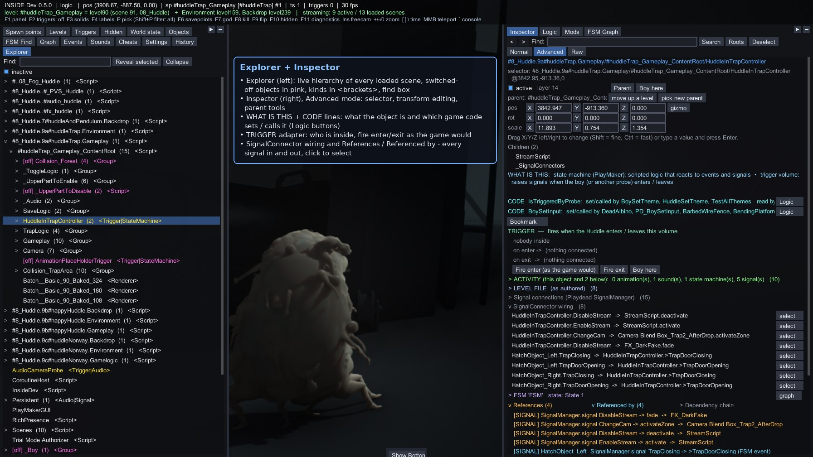
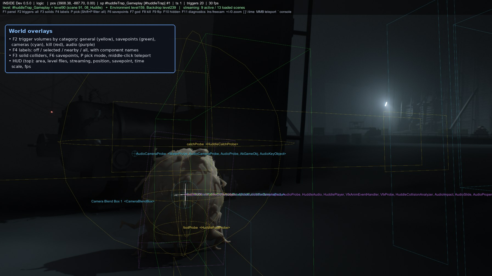
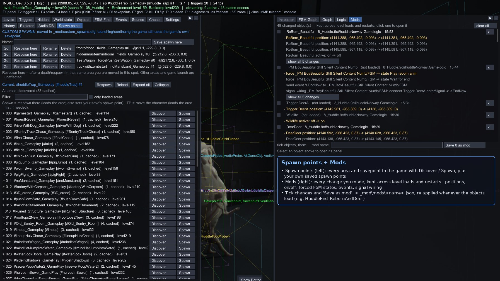
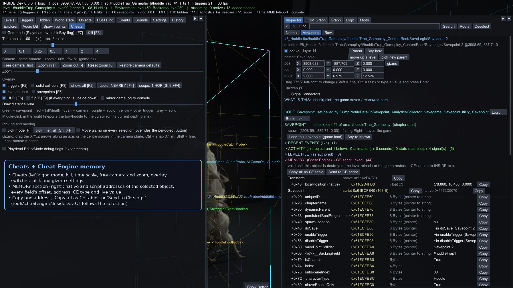
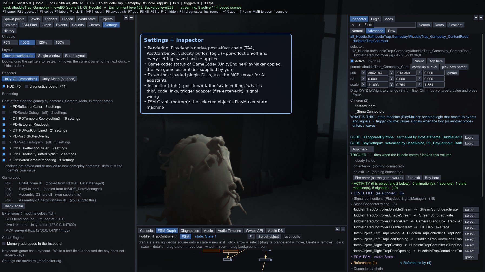
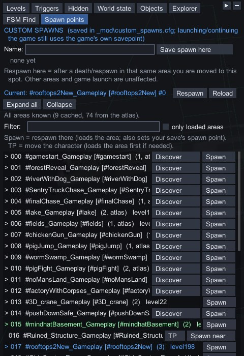
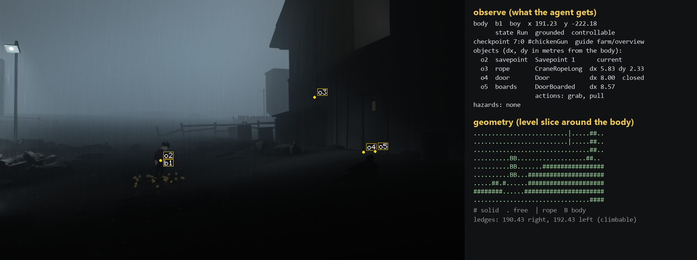
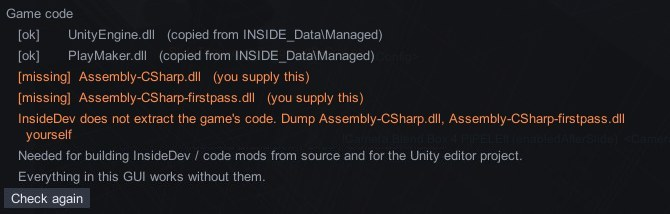

# InsideDev: a runtime editor for INSIDE

InsideDev is an in-game editor and explorer for Playdead's INSIDE (Unity 5.0.4f1). Browse and edit the live scene, see how objects, signals, PlayMaker state machines, code and sound are connected, save your changes as mods, let an AI assistant look at and play the game through MCP, and film the game with many cameras or straight from its own frames.

> Unofficial fan-made tool, not affiliated with or endorsed by Playdead. INSIDE is a trademark of Playdead.
> This repository contains no game files or game code; you need your own copy of the game.

**Download:** the [latest release](https://github.com/RedMatterGG/InsideDevTool/releases/latest) holds everything in one zip. What changed in each version is in the [release notes](https://github.com/RedMatterGG/InsideDevTool/releases).

## Contents

- [What it does](#what-it-does)
- [Screenshots](#screenshots)
- [Install](#install)
- [The editor](#the-editor): [panels](#panels), [keys](#keys), [console and settings](#console-and-settings), [mods](#mods), [level atlas](#level-atlas), [Cheat Engine](#cheat-engine)
- [AI assistants (MCP)](#ai-assistants-mcp) and [MCP character control](#mcp-character-control)
- [Filming](#filming): [game video](#video-of-the-games-own-frames-grec-and-rec), [director camera](#live-director-camera-campath), [panorama](#360-degree-panorama-pano), [scene recorder](#scene-recorder), [MultiCam](#multicam), [audio capture](#game-audio-capture)
- [Lab modules](#lab-modules), [Python tools and guide playbooks](#python-tools-and-guide-playbooks)
- [Switches and defaults](#switches-and-defaults), [What it costs](#what-it-costs), [Security](#security)
- [File bridge](#file-bridge), [Debugger](#debugger), [Game code and building](#game-code), [Folder layout](#folder-layout), [For AI agents](#for-ai-agents)

## What it does

| Part | What you get | File |
|---|---|---|
| Editor | Docked panels over the running game: explorer and inspector, visual PlayMaker editor, signal and code links, sound database, world overlays, triggers, hidden objects, spawn points, cheats, undo history, mods, a console with `help`, `doctor` and `cfg` | `bin\InsideDev.dll` |
| MCP server | An AI assistant (Claude or any MCP client) looks at and edits the live game: scene search, inspector, state machines, signals, screenshots, any console command | `bin\InsideDev.Mcp.dll` |
| Character control and film tools | The assistant plays the game: it sees the world as data, presses the game's own controls for exact logic steps, walks to points, uses objects and waits for conditions. Also the game-frame video `grec`, the director camera `campath` and the 360 degree panorama `pano` | `bin\InsideDev.Play.dll` |
| Scene recorder | Records what moves in a scene into a take folder and plays it back in a frozen scene you can fly through | part of the editor |
| MultiCam | Films one scene with many virtual cameras at once, or records it once and films every camera from the recording | part of the editor |
| Game audio capture | Writes the game's own sound output to WAV with sync markers | part of the editor |
| Native readback | Copies the game's frames on the GPU for the video recorders | `bin\InsideReadback.dll` |
| Lab modules | Measurements of how the engine behaves under recording and replay, an input determinism test | `bin\InsideDev.ReplayLab.dll`, `bin\InsideDev.Det.dll` |
| Python tools | Command-line control, recording reader, MultiCam spec check, compositor, QA, audio alignment | `tools\*.py` |

Everything beyond the editor itself is optional: copy only the files you want. Nothing records, mutes, moves a camera or changes the game until you ask for it, and the editor's own scanners sleep while nobody uses the tool.

## Screenshots

<table>
<tr>
<td width="50%" valign="top"><a href="docs/screenshots/fsm-graph.jpg"></a><br><b>FSM Graph: visual PlayMaker editor</b></td>
<td width="50%" valign="top"><a href="docs/screenshots/explorer.jpg"></a><br><b>Explorer + Inspector</b></td>
</tr>
<tr>
<td width="50%" valign="top"><a href="docs/screenshots/fsmfind.jpg"></a><br><b>FSM Find + object Graph</b></td>
<td width="50%" valign="top"><a href="docs/screenshots/audio-logic.jpg"></a><br><b>Audio DB + code Logic</b></td>
</tr>
<tr>
<td width="50%" valign="top"><a href="docs/screenshots/overlays.jpg"></a><br><b>World overlays</b></td>
<td width="50%" valign="top"><a href="docs/screenshots/spawns-mods.jpg"></a><br><b>Spawn points + Mods</b></td>
</tr>
<tr>
<td width="50%" valign="top"><a href="docs/screenshots/cheats-memory.jpg"></a><br><b>Cheats + Cheat Engine memory</b></td>
<td width="50%" valign="top"><a href="docs/screenshots/settings.jpg"></a><br><b>Settings (post effects, game code, extensions)</b></td>
</tr>
</table>

## Install

### Requirements

- Windows 64-bit and the Windows version of INSIDE (Unity 5.0.4f1). The level atlas matches one game build and switches itself off on another; everything else finds what it needs in the running game by name.
- For the Steam copy: the Steam client must be running when the game starts. Without it the game closes itself about 2 s after it starts, before InsideDev can do anything (`python -I tools/inside_ctl.py doctor` says so from outside).
- Optional, per feature:
  - .NET Framework 4.x (part of Windows) for the stdio MCP launcher and InsideMuter
  - ffmpeg 6.1 or later for the video recorders, with an H.265 or H.264 encoder (`film.encoder auto` tries NVENC, AMF, Quick Sync, then x265 and x264; MultiCam pipes default to NVENC)
  - Python 3.9 or later for `tools\*.py`

### Files

`<game>` is the INSIDE folder (the one with `INSIDE.exe`). Create `<game>\_mod\` first, then copy with the game closed:

| File in this repo | Copy to | What it is |
|---|---|---|
| `bin\version.dll` | game folder, next to `INSIDE.exe` | proxy loader: forwards the real `version.dll` and starts InsideDev once the game's code has loaded |
| `bin\InsideDev.dll` | `<game>\_mod\` | the editor |
| `bin\InsideDev.Mcp.dll` | `<game>\_mod\` | optional: MCP server for AI assistants |
| `bin\InsideDev.Play.dll` | `<game>\_mod\` | optional: MCP character control, world tools, `grec`, `rec`, `pano`, `campath`; needs `InsideDev.Mcp.dll` |
| `bin\InsideReadback.dll` | `<game>\INSIDE_Data\Plugins\` | optional: GPU frame readback. Needed by `grec`, `rec` / `time {op:"record"}` and the video ops of the `film` tool; makes MultiCam frame grabs faster |
| `bin\InsideDev.ReplayLab.dll`, `bin\InsideDev.Det.dll` | `<game>\_mod\` | optional: lab modules |
| `guide\` | `<game>\_mod\guide\` | optional: playbooks for the MCP `guide` tool |
| `mods\*.json` | `<game>\_mod\mods\` | optional: example mods, all shipped disabled (see [Mods](#mods)) |
| `data\atlas\*.tsv` | `<game>\_mod\atlas\` | optional: level atlas |
| `tools\mcp\InsideDev.McpStdio.exe` | anywhere | optional: stdio launcher for MCP clients that start a local program; client configs in `tools\mcp\clients\` |
| `tools\muter\InsideMuter.exe` | `<game>\_mod\muter\` | optional, **mutes the game while it runs**: only for silent audio captures |
| `tools\cheatengine\InsideDev.CT` | anywhere | optional: Cheat Engine table |
| `tools\*.py`, `specs\*.json` | keep them in the repository folder | optional: Python tools and example MultiCam specs |

Settings, logs, mods, recordings and caches all live in `<game>\_mod\`.

### First run

1. Start the Steam client, then the game. **F1** opens the editor, the backquote key opens its console.
2. Type `ping`. The answer is `pong  InsideDev <version>`.
3. Type `doctor`. It checks every part (loader, modules and their versions, ffmpeg and encoders, free disk, window, time scale, background mode) and prints one line per check, with the fix after `->` for anything that fails. `doctor json` gives the same as one JSON object.
4. With the MCP server installed, register it in your client while the game runs, for Claude Code: `claude mcp add --transport http inside-play http://127.0.0.1:47811/mcp/play`, then call `observe`. Without a client, `curl.exe http://127.0.0.1:47811/status` answers with the server state.

If F1 does nothing, read `<game>\_mod\hook.log` (the loader: did it run, find `_mod\InsideDev.dll` and start it, and if not, why), then `<game>\_mod\insidedev.log` (the editor). Both are written anew at every start. An antivirus may quarantine `version.dll`.

> [!IMPORTANT]
> A minimized game window pauses the game: commands and MCP calls then wait or time out. Keep the window restored; it may stay behind other windows.

**Uninstall:** delete `version.dll` from the game folder and `InsideReadback.dll` from `<game>\INSIDE_Data\Plugins\`, and `<game>\_mod\` if you want the settings gone. If InsideMuter ran with `--keep-muted`, run `InsideMuter unmute` or unmute INSIDE in the Windows volume mixer.

## The editor

### Panels

A docked workspace (left, right and bottom docks, resizable; ▸ moves a panel to the next dock) or a single window; UI scale 75 to 150 %. Text fields take Ctrl+V, Ctrl+C and Ctrl+Backspace, and the boy gets no keys while one has the focus. **Ctrl+P** opens global search and the command palette; bookmarks remember places.

- **Explorer and Inspector**: the live scene tree. The inspector has Normal, Advanced and Raw modes and sections for ACTIVITY (animations, sounds, state machines and signals below the selection), MATERIALS, LEVEL FILE (the object against its level file: as authored, changed by you, changed in game) and ATLAS; adapters for savepoints, PlayMaker FSMs (fire, force), animation (who plays it, play / stop, pose slider) and the Animator.
- **FSM Graph and FSM Find**: a visual PlayMaker editor. Action settings are editable (numbers, strings, bools, events, enums, on / off) with undo per setting; connections to switched-off objects link up when those wake; a hit in FSM Find opens here; with the atlas, states no event leads to and events nothing sends are drawn grey. Delete removes the selected transition (undoable).
- **Levels, Triggers, Hidden, World state, Objects**: the level list, nearby triggers, objects the game switches off and never on (the Hidden tab scans while it is drawn; `hidden on` keeps a passive scanner running, results in `_mod\hidden\`; with the atlas also "All levels"), and the object database search (`t:Type`, `k:kind`, hidden / active).
- **Events**: live history of signals, FSM events, sounds and animation clips, with filters.
- **Audio, Sounds, Audio Timeline, Wwise API**: sound files per event (name, codec, length; never extracted), "why did this play" call stacks, a timeline, audition, trigger the original or an override, audio rules (mute, nuke, replace, force switch / state / RTPC), metadata export to `_mod\export\`.
- **History**: every edit with before and after; undo and redo (Ctrl+Z / Ctrl+Y), revert per property or all.
- **Mods**: see [Mods](#mods).
- **Console and Diagnostics**: the log console runs every command (Up / Down for earlier commands, kept across restarts; a filter box; a click copies a line); render and per-subsystem cost diagnostics.
- **World labels**: each label shows the first component names and "+N" for the rest, labels never cover each other, and the selected object shows its full list (`labels types <n|all>`).

### Keys

| Key | Does |
|---|---|
| F1 | editor panel |
| F2 | trigger overlay: all, general, savepoints, cameras, kill, audio, logic, water, fx, streaming |
| F3 / F4 | solids / labels (off, selected, nearby, all) |
| Shift+F4 | overlay scope: selected, one hop, two hops, nearby, all |
| P / Shift+P | pick in the world / pick filter |
| F5 / F6 | HUD / savepoints |
| F7 / F8 / F9 | god mode / kill / flip |
| F10 / F11 | hidden objects / diagnostics |
| Insert | free camera (flight keys: [docs/RECORD_REPLAY.md](docs/RECORD_REPLAY.md) section 7) |
| `+` `−` `0` | zoom the game camera |
| `[` `]` `\` | time scale slower, faster, normal |
| middle mouse | teleport the boy |
| `` ` `` | console (Up / Down: earlier commands) |
| Ctrl+Z / Ctrl+Y (Ctrl+Shift+Z) | undo / redo |
| Ctrl+P or Ctrl+K | command palette |
| Alt+Left / Alt+Right, mouse buttons 4 / 5 | selection history |
| Home (with Play) | flag a moment for the AI assistant (`play.notes_key` remaps it, `none` switches it off) |

The game keys (F7, F8, `[ ] \`, zoom, P and the middle-click teleport) also work with the panel closed; none of them act while a text field has the focus. `hotkeys.game=0` (or the toggle in the Cheats tab) keeps F7, F8, `[ ] \` and the teleport for the open editor only. The overlay choices of F2, F3, F4, Shift+F4, F6 and F10 are saved.

<a href="docs/screenshots/triggers-f2.jpg"></a>

### Console and settings

Every command works the same in the in-game console, through the [file bridge](#file-bridge), `POST /cmd` and the MCP `command` tool.

- `help` lists every command, `help <command>` prints the usage of one. [docs/COMMANDS.md](docs/COMMANDS.md) lists every command, setting and MCP tool argument; it is generated from the code.
- `doctor [json]` is the self-check of every part.
- `cfg [filter] [json]` lists every setting with its value, default and meaning; `cfg get <key>`, `cfg set <key> <value>` and `cfg reset <key>` change one while the game runs. Settings are `key=value` lines in `<game>\_mod\editor.cfg`; the file is rewritten when a setting changes (comment lines are dropped then).
- Status commands have a `json` form: `state json`, `where json`, `perf json`, `mod list json`, `srec status json`, `acap status json`, `mcam status json`, `cam status json`.
- `perf` splits InsideDev's time per subsystem and counts garbage collections; `perf hide` / `perf show` switch renderers of a part of the scene off and on to measure what they cost.
- `quit` closes the game the way its own exit does.

Protected settings (`mcp.*`, `play.cheats`, `play.save_guard`, `play.guide_dir`, `ffmpeg.path`, any key with `token` or `password`) are refused through MCP and `POST /cmd`: change them in the in-game console, through the file bridge, or in `editor.cfg` with the game closed. Token values are never printed.

### Mods

A mod is a JSON file in `<game>\_mod\mods\<name>.json`: selectors and values, never game assets. Make one from your edits (`mod record <name> [description]`, or Record as mod in the History panel), then enable, disable, dry-run or validate it in the Mods panel or with `mod list | show | enable | disable | dry | validate | delete <name>`. A mod file with a JSON error is left untouched, and the error names the line and column.

**A mod only works in its own level.** Its operations are grouped by level, looked up once when that level has loaded (after `mods.settle` seconds of quiet streaming), only inside that level, retried for late content, and left alone until the next load; a respawn applies them again. Mods of levels that are not loaded cost nothing. `mod list` shows each mod's levels and cost.

Example mods in `mods\`, all shipped disabled (enable them in the Mods panel or with `mod enable <name>`):

- `HuddleEnd_RebornAndDeer`: at the ending, the unused "boy is reborn" sequence plays in front of the huddle and the unused deer run past.
- `TestSubjectA_WindowMoment`: in the Education Rooms test chamber, test subject A plays his unused 19 s moment with the curtains.
- `HuddleCafeteria_HeadExplosions`: when the huddle crashes into the office crowd, up to four of them lose their heads, through the crowd's own switched-off branch.

**Extension modules.** Any `<game>\_mod\InsideDev.*.dll` is loaded as an extension; `ext` lists them with their cost and levels, and `ext load` picks up new files without a restart. An extension that implements `IInsideDevLevelScoped` is ticked only while its levels are loaded, and `LevelGate` in the core helps mod authors bind code to levels. The log names an extension whose tick is slow; `ext.autoDisable=1` switches off one that keeps throwing.

### Level atlas

The game only has the levels it has streamed in. The atlas (`data\atlas\*.tsv`, copied to `<game>\_mod\atlas\`) is a static index of all 253 level files, so the editor knows every level from the first frame:

- Hidden: "All levels (atlas)" lists objects switched off in the level files: switched on later by the game (and by what), never switched on by anything, or unclear
- Inspector ATLAS section and FSM Graph: signal wires that never connect, PlayMaker states no event in the game leads to, events nothing sends
- Spawn points: savepoints of areas not discovered yet (marked "atlas"; never written to `spawns.cache`)
- Console: `atlas` (status), `atlas find <text>`, `atlas level <n|name>`, `atlas check` (finds every atlas object of the loaded levels in play and maps it back); Ctrl+P "Hidden: all levels (atlas)" switches the Hidden list

<table>
<tr>
<td width="50%" valign="top"><a href="docs/screenshots/atlas-hidden.jpg"></a><br><b>Hidden: all levels from the atlas</b></td>
<td width="50%" valign="top"><a href="docs/screenshots/atlas-inspector.jpg"></a><br><b>Inspector ATLAS section</b></td>
</tr>
<tr>
<td width="50%" valign="top"><a href="docs/screenshots/atlas-fsm.jpg"></a><br><b>FSM Graph with atlas: unreachable states in grey</b></td>
<td width="50%" valign="top"><a href="docs/screenshots/atlas-spawns.jpg"></a><br><b>Spawn points of areas not discovered yet</b></td>
</tr>
</table>

It holds names, paths, positions and statuses only (no meshes, textures, audio or code). It records the size of every level file and switches itself off on another game build. How it is made: `tools\atlas\README.md`. Its two inputs come from tooling that is not part of this repository, so the shipped `data\atlas` matches the current game build only.

### Cheat Engine

Turn on Settings > Cheat Engine for the Inspector's MEMORY section; "what is at 0x…" resolves an address to an object and field, or a code address to a method. Load `tools\cheatengine\InsideDev.CT` (or put `InsideDev.lua` in CE's autorun): it follows the editor's selection and adds right-click "InsideDev: what is this?" and "which method?". Its menu item "InsideDev: link status" says whether the editor and the table are linked.

## AI assistants (MCP)

`InsideDev.Mcp.dll` is a [Model Context Protocol](https://modelcontextprotocol.io) server that runs inside the game, so an AI assistant or any MCP client can look at and edit the live game. Tested with Claude; it follows the standard protocol (versions 2024-11-05 to 2025-11-25), so other MCP clients work too.

- **Endpoint:** `http://127.0.0.1:47811/mcp` (Streamable HTTP), also on `[::1]`. It listens on this computer only, never on the network; see [Security](#security).
- **Profiles** by path: `/mcp/dev` (also `/mcp`) = the editor tools, `/mcp/play` = character control, `/mcp/all` = both. With Play installed: play 15, dev 34, all 41 tools (a client that takes at most 40 tools should use `/mcp/play` or `/mcp/dev`). Without Play: dev 14, and the play profile only has `screenshot`.
- **Dev tools:** `game_state`, `screenshot`, `show_panel` (open a panel, move it to a dock, resize the dock), `find_objects`, `inspect`, `select`, `set_active`, `fsm_graph`, `fsm_find`, `fsm` (send event, force state, variables), `signal`, `log`, `jobs`, and `command` (any console command; `commands:[...]` runs several, `wait:"<status command>"` waits for a result). Edits are recorded in History. A plain object name is matched loosely (exact name, else text inside the name, the one nearest the boy); `set_active`, `fsm` and `signal` report `matches` and `candidates` and refuse with `strict:true`.
- **Screenshots:** preview (inline image; `format:"jpeg"` makes it several times smaller), `marked` (with the ids of `observe`, needs Play) and `full` (file only, resource `inside://shots/<file>`; the newest 200 are kept in `_mod\shots\`). `fast:true` returns once the file is written.
- **Jobs:** a tool that runs over many frames holds the control lane as a job, and a second one gets `busy` at once. `jobs` lists, awaits and cancels them; requests with a progress token get progress over SSE; `notifications/cancelled` stops a call. Every result is one JSON object with `ok` first (`error.code`, `hint`, `warnings` when they apply).
- **Plain endpoints** for scripts without an MCP client: `POST /cmd` (one command as the text body, the reply as text; `?wait=<status command>` waits for the result), `POST /cmds` (several commands in one request and one frame, the replies as JSON), `GET /status` (server and game health as JSON, answered without the game's main thread), `GET /state` (the observe JSON, needs Play), `GET /ping`.
- **Restore:** after a client has used the server, the game is put back 600 s after the last tool call (`mcp.idle_restore_s`) and 60 s after the last client went away (`mcp.restore_on_close_s`); `0` switches either off. Restore cancels the running job and undoes what the tools changed (panels opened by `show_panel`; with Play also the clock, the input, vSync and the world tools' changes). Both wait while a recording is running.
- **Access:** `mcp token new` (in the in-game console or through the file bridge) makes the server require `Authorization: Bearer <token>`; `mcp tools <allowlist>` limits the tools (`tool`, `profile:*`, `profile:tool`, `*`); `mcp hosts <names>` accepts more Host names. Changing calls are logged to `_mod\mcp_audit.jsonl`.
- **In game:** `mcp` (status; `mcp status json`), `mcp on|off`, `mcp port <n>`, `mcp sessions [json]`, `mcp jobs`, `mcp providers`, `mcp restore`, `mcp selftest` then `mcp test` (a real HTTP session against the endpoint). Settings > Extensions shows the endpoint.

An HTTP client must be registered while the game runs; if the game started later, reconnect the server in the client. Clients that start a local program (stdio) use `tools\mcp\InsideDev.McpStdio.exe`, which can be connected before the game starts: it always lists `inside_status`, offers only that tool until INSIDE is running, and tells the client when the game's tools appear or go away. Options: `--profile play|dev|all` (default dev), `--port <n>` (also `INSIDE_MCP_PORT`), `--url <endpoint>`, `--token <t>` (also `INSIDEDEV_MCP_TOKEN`).

```
Claude Code:     claude mcp add --transport http inside-dev http://127.0.0.1:47811/mcp/dev
                 claude mcp add --transport http inside-play http://127.0.0.1:47811/mcp/play    (character control)
Claude Desktop:  claude_desktop_config.json ->
                 { "mcpServers": { "inside-dev": { "command": "C:\\path\\to\\InsideDev.McpStdio.exe" } } }   (escape \ as \\)
                 add "args": ["--profile", "play"] for the play profile
Other clients:   HTTP url http://127.0.0.1:47811/mcp/dev, or the stdio command above (optional --port <n>)
```

Ready-made files for Claude Code, Claude Desktop, Cursor, VS Code, Codex and Gemini CLI are in `tools\mcp\clients\`. Full reference: [docs/MCP.md](docs/MCP.md); every tool argument: [docs/COMMANDS.md](docs/COMMANDS.md).

## MCP character control

`InsideDev.Play.dll` lets an AI assistant play INSIDE through MCP. It reads the world as JSON (the boy or the huddle, nearby objects with ids, kinds and actions, hazards, the checkpoint, a slice of the level geometry), presses the game's own controls for an exact number of logic steps, walks to a point, uses objects, waits for conditions, respawns at checkpoints, goes through menus, reads playbooks, and records and replays input tracks. It needs only the MCP server. Input goes into the game's input system, not the Windows keyboard, so the game window does not need focus.

<a href="docs/screenshots/mcp-observe.jpg"></a>

- **Install:** `bin\InsideDev.Mcp.dll` and `bin\InsideDev.Play.dll` to `<game>\_mod\` (or copy them while the game runs and type `ext load`). Connect the client to `http://127.0.0.1:47811/mcp/play` (stdio: `--profile play`).
- **Play tools (15):** `observe`, `act`, `move_to`, `interact`, `wait_until`, `time`, `checkpoint`, `menu`, `screenshot`, `guide`, `notes`, `restore`, `input_track`, `geometry`, `film`.
- **The loop:** `observe` -> `act` / `move_to` / `interact` -> `wait_until` -> `observe`. `observe {detail:"delta"}` lists only what appeared, disappeared or changed. `act {seq:"R1.2 J R0.4+J"}` takes a short input script. `wait_ready_s` on `act`, `move_to` and `interact` waits for the game to take input instead of being refused. `checkpoint {op:"goto", name}` loads a checkpoint by name. Ids of objects that exist again after a load resolve again; an id whose object is gone answers `stale_id`.
- **Clock:** the first action call switches to step mode: the game is frozen between calls and runs only inside a call, for exactly the steps it asks for. `time {op:"realtime"}` lets it run normally. `restore` puts back the clock, the input (your pad and keyboard work again), vSync and every change the tools made; `restore {dry_run:true}` lists what it would undo.
- **World tools** on the dev profile: `level`, `stream`, `save`, `ui`, `camera`, `logic`, `body`, `hazard`, `audio`, `render`, `reflect`, `state_diff`, `run_scenario`, plus the shared `observe`, `time`, `wait_until`, `restore`, `geometry`, `input_track`, `film`.
- **Without an MCP client:** the console command `ctl` drives the boy (`ctl run right 1.2`, `ctl seq "R1.2 J R0.4+J"`, `ctl goto <x>`, `ctl track rec | play`, `ctl status`, `ctl stop`), also through the file bridge, `POST /cmd` and `tools\inside_ctl.py`.
- **Off by default:** `play.cheats` (checkpoint jumps), `play.save_guard` (save backups and confirms before loads that write the save), `play.hold_timeout_s` (release held input after a quiet time). Loads through the tools can write `INSIDE.sav` like normal play.

> [!TIP]
> After a load, wait for the requested checkpoint (`wait_until {any:[{ready:true}]}` or `level {op:"wait_ready"}`) before acting. In step mode, places timed to the music drift from the music. The MCP restore after 600 s without a tool call stops input track recordings.

Full reference with every parameter, workflows and pitfalls: [docs/PLAY.md](docs/PLAY.md).

## Filming

### Video of the game's own frames: `grec` and `rec`

`grec` (with Play and `InsideReadback.dll`) films the game's own frames into a video file. At the end of every n-th rendered frame the plugin copies the back buffer on the GPU, and background threads hand the frames to a separate ffmpeg process. Windows over the game, focus changes and other programs never reach the file, and a slow encoder never holds the game back.

- **Video length equals game time**, so the sound lines up: frames are placed by game time, and a 120 s recording under load gave 120.13 s of video for 120.10 s of game time. `<file>.times.csv` next to the video gives each frame's game time for exact audio alignment. Time in which an agent's game stands frozen between calls is left out, and stepped runs are recorded frame by frame.
- `grec start [file.mkv] [every n-th frame] [cq] [enc=auto|<encoder>] [fps=<rate>]`, `grec stop [wait]`, `grec status [json]`. A bare file name goes to `<game>\_mod\recordings\`.
- `rec start` / `rec stop` and the MCP `time {op:"record"}` / `{op:"record_stop", review_fps}` are the same recorder with a target frame rate and optional review frames. Desktop capture is still there as `rec start ... desktop` or `source:"desktop"`, for the rare case that needs the screen, other windows included.
- The MCP `film` tool (play and dev profiles) is one typed door to `grec`, `pano` and `campath`, with structured results.
- Encoder: `film.encoder` (default `auto`: the first of NVENC, AMF, Quick Sync H.265, x265, x264 whose test encode works). A failed ffmpeg is reported at once, and ffmpeg ends with the game.

### Live director camera: `campath`

`campath` puts the main game camera on a pose path planned in advance while the game itself plays: live particles, time-animated shaders, mod effects and anti-aliasing stay the game's own. `mcam passes` writes a path for every camera of a MultiCam spec, or any script can write the two CSV files. The pose goes on the camera after the game's camera script, so the game's camera logic, culling and input stay untouched. In director mode the plan also drives the clock: the game is held still during the plan's pauses and runs at the plan's speed otherwise. `campath mount` rides the camera on a transform, for example the boy's head for a first-person pass, with optional smoothing of the head bob, a level horizon, timed looks and limits for the free look up and down.

### 360 degree panorama: `pano`

One command writes an equirectangular PNG that panorama viewers open directly, with a JSON file that says where the eye was. Each of the six cube faces is an ordinary game frame, so the picture is what a screenshot would show there: fog, water, the post chain and everything the game streams in for the camera. A 4096x2048 panorama takes about 2.5 s.

How to use all three: [docs/PLAY.md](docs/PLAY.md) sections 4.5 to 4.8 and workflows 7.7 and 7.8.

### Scene recorder

The scene recorder writes what moves in a scene (transforms, bones, particles, lights, materials, the game camera and timed events) into a take folder (`scene.srec` plus CSV and JSON sidecars). The viewer then holds the frozen scene at any time of the recording while you fly the free camera, so a take can be scrubbed and looked at from any side.

- `srec record start [<dir>] [key=value ...]`, `srec record stop [keep|load]`, `srec record status [json]`, `srec event <name>`
- `srec load <dir|last> [play [speed] [loop]] [t=<time>|@event]`, `srec reload`, `srec play [speed]`, `srec pause`, `srec seek <t|@event>`, `srec step next|back|<s>`, `srec end`
- `srec objects [filter]`, `srec probe [n]`, `srec status [json]`, `srec list`

A relative `<dir>` is a folder under `<game>\_mod\srec\`; without one, `take_<date_time>`. A folder that already holds a recording is refused unless you add `overwrite=on`. Free disk space is checked before the start (`record.minFreeMB`), and a full disk stops the recording cleanly. Start a recording only after the load has finished; objects spawned at run time replay only in the game session that recorded them.

Reference: [docs/RECORD_REPLAY.md](docs/RECORD_REPLAY.md); design notes: [docs/REPLAY_DESIGN.md](docs/REPLAY_DESIGN.md).

### MultiCam

MultiCam films one scene with many cameras at once. A JSON spec describes the cameras (static, follow, orbit, rails, director shots, overview, event-driven), cues, slow motion, motion blur and the output; `mcam` runs it in the game and writes one video (or frame folder) per camera with pose and event logs. Replay mode records the scene once and then films every camera from the recording, one pass per camera, so every angle shows the same performance.

<table>
<tr>
<td width="50%" valign="top"><a href="docs/screenshots/multicam-layout.jpg"></a><br><b>One recorded take, game camera plus three tracking cameras in one layout</b></td>
<td width="50%" valign="top"><a href="docs/screenshots/multicam-game-vs-director.jpg"></a><br><b>Game camera vs director camera at the same recorded moment</b></td>
</tr>
</table>

- `mcam check <spec> [json]`, `mcam preview <spec> [<out>] [t]`, `mcam rehearse`, `mcam start`, `mcam record`, `mcam take <spec> [<out>]` (record once, then every camera), `mcam replay <spec> [<out>] [resume]` (skips passes that already finished), `mcam passes`, `mcam golden`, `mcam status [json]`, `mcam stop`, `mcam abort`, `mcam show <camera> [t]`; `mcam help` lists all.
- Without `<out>` a take goes to `<spec folder>\takes\<spec name>_<date>_<time>`; a folder that already holds a take is refused unless `overwrite=on`.
- Helpers: `cam pose x y z yaw pitch [fov] [seconds] [roll]`, `cam look <target>`, `cam back`, `cam json [name]` (prints the current view as a spec camera), `cam status [json]`, `cam off`; `clean on|off` (every editor overlay off for clean frames); `hud on|off`; `gamma <0..1>|reset`; `seed <n>` (repeatable game randomness).
- A run saves and restores the session (input lock, overlays, vSync, resolution); the game stays frozen after a replay run until `ts 1`. Video output (`output.format: "pipe"`) needs ffmpeg; `InsideReadback.dll` makes frame grabs faster.
- Two example specs are in `specs\`; the offline checker and the compositor are [Python tools](#python-tools-and-guide-playbooks).

Reference: [docs/MULTICAM.md](docs/MULTICAM.md) (every spec field, workflows, pitfalls); short guide in Russian: [docs/MULTICAM_ru.md](docs/MULTICAM_ru.md); design notes: [docs/MULTICAM_DESIGN.md](docs/MULTICAM_DESIGN.md).

### Game audio capture

`acap` writes the game's own sound output (Wwise) to a WAV file with sync markers: on its own (`acap start <name>`, `acap mark <label>`, `acap stop`) or as part of a recording (`srec record start <dir> audio=on`, or a MultiCam replay spec with `replay.audio.capture: "record"`).

- Default output `audible`: the game sound plays normally while it is captured, at the game's own volume. Nothing is muted and the master volume is never raised.
- Output `muted` (opt-in, `acap output muted`): for captures while the speakers or headphones must stay silent. The master volume is held at 0 and opened only inside a capture window, and only while the InsideMuter heartbeat proves every INSIDE audio session is muted in Windows. It is unlocked only by flag files that a passing lab audio stage writes, and should be run only with the explicit OK of the person wearing the headphones. `acap output audible` switches back.
- `acap status` and `acap preflight` show the output, the game volume and why a capture would be refused.

**InsideMuter** (`tools\muter\InsideMuter.exe`) is off by default and never starts by itself. While it runs, it **mutes the sound of every running INSIDE.exe in Windows** (it calls mute on the game's audio sessions every 50 ms and never changes a volume, at about 3 % of one core) and writes a heartbeat file every 250 ms. Copy it to `<game>\_mod\muter\` and start it there before the game, or start it anywhere with `--heartbeat <path>`. It exits 10 s after the last INSIDE.exe has ended and un-mutes the sessions it muted (`--keep-muted` leaves the mute). `InsideMuter status`, `InsideMuter stop` and `InsideMuter unmute` ask and end it from a command line.

Reference: [docs/AUDIO.md](docs/AUDIO.md).

## Lab modules

Two optional DLLs for measuring how the game behaves under recording and replay. Nothing runs until one of their commands is called; they work in the console, the file bridge and the MCP `command` tool.

- `InsideDev.ReplayLab.dll` (`lab help`, `lab list`, `lab l1` ... `lab l12`, `lab status`, `lab stop`, `lab out <dir>`): twelve tests, each measuring one engine behaviour the recorder and the replay depend on (write order, skinning and blur, physics at time scale 0, particles, Wwise output capture, random generators, forced cullers, update callbacks, static shadows, shader time, ropes, camera-driven transforms). Each restores what it changed and writes a verdict, `result.json`, a log and grabs to `<game>\_mod\replay_tests\<test>\`. The audio test L5 has stages that need InsideMuter and the user's OK with headphones on.
- `InsideDev.Det.dll` (`det ...`): the input replay determinism test at ChickenGun. It records the input of a run per logic step, feeds it back in later runs and logs the scene per step to `<game>\_mod\det\<name>\`; `tools\det_compare.py` compares runs.

Reference: [docs/LAB.md](docs/LAB.md).

## Python tools and guide playbooks

`tools\*.py` need Python 3.9 or newer; keep them in the repository folder and run them from there as `python -I tools/<script>.py`. None of them starts or patches the game, and none has a built-in path of a particular machine (paths are arguments or environment variables: `INSIDE_GAME`, `INSIDE_BRIDGE`, `INSIDE_MCP_PORT`, `INSIDEDEV_MCP_TOKEN`, `FFMPEG`, `FFPROBE`, `INSIDE_LEVEL_INDEX`, `MCAM_OUT`). Exit codes: 0 ok, 1 the result is bad, 2 input or usage error (or the game is not reachable), 3 refused.

| Script | What it does |
|---|---|
| `inside_ctl.py` | console and bridge commands from a command line (`POST /cmd`, the file bridge as fallback): `ctl` jobs, `state`, `snapshot`, `seq`, `wait` (until the game is ready), `doctor` (self-check from outside), `repl`, `-f <file>` |
| `inside_link.py` | the connection library under `inside_ctl.py` and `mcam_previews.py` (HTTP, token, file bridge fallback, a small MCP client); standard library only |
| `srec_tool.py` | reads and verifies `scene.srec` recordings, reports spec events and content checks |
| `mcam_spec_check.py` | offline lint of MultiCam specs, segment table, cost and disk estimate |
| `mcam_compose.py`, `mcam_take.py` | angle videos, layouts, director blocks and cuts from a take (H.265); `mcam_compose.py doctor` checks ffmpeg and the encoders first, `--resume` skips finished outputs |
| `mcam_qa.py`, `mcam_track_check.py`, `fast_review.py` | take checks with exit codes, contact sheets, the replay golden test, subject tracking, review frames |
| `mcam_previews.py` | stills of every camera of a replay spec at every beat, from a recording in the running game |
| `mcam_audio.py` | fixes (with a `.bak`), aligns and checks captured WAV files, builds a take's sound track |
| `mcam_ff.py` | the ffmpeg and ffprobe the tools use, with their versions |
| `det_compare.py` | compares `det` runs by logic step |

The compositor and QA need numpy, opencv-python, Pillow and ffmpeg (NVENC / NVDEC by default; `--codec x265` and `--cpu` without an NVIDIA GPU); numba makes the compositor faster and matplotlib draws the QA plots (both optional). `mcam_previews.py` needs Pillow, `mcam_audio.py` numpy.

`guide\` holds Markdown playbooks for an AI that plays the game: every area (forest, farm, city, sewers, offices, mines, lab, huddle), the mechanics, safety rules, secrets, and example scenarios for `run_scenario`. Copy it to `<game>\_mod\guide\` for the MCP `guide` tool; `play.guide_max` (`hint`, `steps`, `solution`) caps the spoilers. The playbooks were written from the game's code and are mostly not verified in play.

Reference: [docs/TOOLS.md](docs/TOOLS.md).

## Switches and defaults

Every feature can be switched on and off. This is the state of a fresh install:

| Feature | Default | On | Off |
|---|---|---|---|
| Background scanners of the editor (object database, audio log, event monitor, Wwise trace, audio catalogue) | `auto`: they run only while the tool is used (a panel open, a command or client call in the last 30 s) and catch up when they wake | `background always` | `background auto`; `background off` = only on request |
| Game hotkeys F7, F8, `[ ] \`, middle-click teleport | on, also with the editor closed | `hotkeys.game=1` | `hotkeys.game=0`: only while the panel is open |
| World labels | 3 component names and "+N" | `labels types <n>`, `labels types all` | `labels types 0` (only the count), `labels off` |
| Passive scanner for hidden objects | off; the Hidden tab scans while it is drawn | `hidden on`, `hidden scan [seconds]` for one run | `hidden off` |
| File bridge `_mod\cmd` | on | `remote on`, `bridge.enabled=1` | `remote off` (this session), `bridge.enabled=0` |
| Bridge snapshot `_mod\cmd\state.txt` | only while command files arrive | `bridge.state=always` (every 5 s) | `bridge.state=auto` |
| Example mods | disabled | Mods panel, `mod enable <name>` | `mod disable <name>` |
| Wwise call tracer in the loader | on | delete `_mod\wwise_off.flag` | create `_mod\wwise_off.flag` |
| Mono debugger port | off | create `_mod\debugger.flag` | delete it, or create `_mod\nodebugger.flag` |
| MCP server | on when `InsideDev.Mcp.dll` is installed | `mcp on` | `mcp off` |
| MCP token, tool allowlist, extra host names | none, every tool, none | `mcp token new`, `mcp tools <list>`, `mcp hosts <names>` | `mcp token clear`, `mcp tools clear`, `mcp hosts clear` |
| MCP restore of the game | 600 s after the last tool call, 60 s after the last client left | `mcp.idle_restore_s`, `mcp.restore_on_close_s` | `0` |
| Character control | idle until a client calls a play tool | install `InsideDev.Play.dll` | `restore`, or remove the DLL |
| Step mode (game frozen between calls) | chosen by the first action call | `time {op:"step_mode"}` | `time {op:"realtime"}`, `restore` |
| vSync (with Play) | `play.vsync_off=1`: off only while an agent works or the clock is held, else the game's own | `vsync off`; `play.vsync_off=2` = off from game start | `vsync on`; `vsync auto` goes back to the rule; `play.vsync_off=0` = never touched |
| Checkpoint jumps, save guard, held-input timeout (with Play) | off | `play.cheats=1`, `play.save_guard=1`, `play.hold_timeout_s=<s>` | |
| Notes hotkey (with Play) | Home | `play.notes_key=<KeyCode>` | `play.notes_key=none` |
| Video recorders `grec`, `rec`, `time {op:"record"}` | off; the source is the game's own frames | `grec start`, `rec start`, `film {op:"grec_start"}` (`desktop` for desktop capture) | `grec stop`, `rec stop`, `restore`, game quit |
| Director camera, panorama | off | `campath load` then `arm` or `start`; `pano [file.png]` | `campath stop`, `restore` |
| Scene recorder, MultiCam | off | `srec record start`, `srec load`; `mcam start / take / replay` | `srec record stop`, `srec end`; `mcam stop`, `mcam abort` |
| Overwriting a take folder | refused | `overwrite=on` | leave it out |
| Camera and frame helpers (`cam`, `hud`, `clean`, `gamma`, `seed`) | off | `cam pose`, `cam look`, `hud off`, `clean on`, `gamma <v>`, `seed <n>` | `cam off`, `cam back`, `hud on`, `clean off`, `gamma reset` (`seed` cannot be undone) |
| Game audio capture | off; output `audible` | `acap start <name>`, `srec record start ... audio=on` | `acap stop` |
| InsideMuter | not running | start `InsideMuter.exe` (it then **mutes the game**) | `InsideMuter stop`; it also exits 10 s after the game and un-mutes |
| Lab modules | not installed | copy the DLLs, then a `lab` or `det` command | `lab stop`, `det abort` |

`cfg` lists every one of the 100+ settings with its meaning, and `doctor` reports the background mode, the window state and anything that would stop a feature.

## What it costs

Measured on a laptop (Core i7-11370H, RTX 3070 Laptop GPU, 2560x1440) in one game scene:

| Situation | Cost |
|---|---|
| Installed, editor closed, no client connected | 0.03 ms per frame, no garbage collection in 95 s |
| Three mods enabled, their levels not loaded | 0.0016 ms per frame for all three; applied in 2.5 ms on entering their level |
| MCP `observe`, or a console command over `POST /cmd` | about 8 ms |
| MCP screenshot at 960 px / 1920 px | 0.09 s / 0.31 s; a 1600 px JPEG is about 120 KB |
| Scene recorder and `grec` recording at once, vSync 60 | the game holds 59.8 fps |

`perf` shows InsideDev's own time per subsystem in your scene, and the log names an extension whose tick is slow.

## Security

InsideDev runs inside the game with the game's rights. What can reach it, and how to close each way:

- **MCP server and plain endpoints.** It listens on `127.0.0.1` and `[::1]` only, never on the network. A request whose `Host` header is not `127.0.0.1`, `localhost` or `[::1]` (DNS rebinding), whose `Origin` is not a page of one of those hosts (`null` included: sandboxed frames, `data:` and `file:` pages), or that carries `Sec-Fetch-Site: cross-site` gets HTTP 403, so web pages in your browser cannot drive the game; an MCP POST with a `Content-Type` other than `application/json` gets 415. Programs on this computer (the stdio launcher, `inside_ctl.py`, scripts, curl) are not affected. `mcp token new` makes every caller show `Authorization: Bearer <token>`; `mcp tools <allowlist>` limits the tools. Without a token, any program on this computer can drive the game through the server.
- **What an MCP call cannot do.** `command` and `POST /cmd` refuse OS input commands (`keyhold`, `focustest`), switching the bridge or the server off, and any change to the MCP port, token, tool list or hosts; `cfg set` refuses the protected settings. No call names a program to start: ffmpeg is found by the tool itself (`ffmpeg.path` in `editor.cfg`, `INSIDEDEV_FFMPEG`, `<game>\_mod\ffmpeg\ffmpeg.exe`, `PATH`, `C:\ffmpeg\bin\ffmpeg.exe`), and a spec's `output.ffmpeg` must be the full local path of a file named `ffmpeg.exe`. `reflect` calls and writes go through an allow list: calls that write files, start processes, load code, reach the network or change the registry are refused. A JSON body nested deeper than 128 levels is refused instead of crashing the game.
- **File bridge** (`_mod\cmd`). Whoever can write into the game folder can run every command through it, including the protected settings. `remote off` stops it for the session, `bridge.enabled=0` keeps it off.
- **Loader** (`version.dll`). It starts `_mod\InsideDev.dll` and, when `<game>\InsideMods\InsideMods.dll` exists, that module too (a separate code-mod project; without that file nothing happens). Mono's debugger agent is off unless `_mod\debugger.flag` exists. The loader never writes a game assembly to disk.

## File bridge

The file bridge works without the MCP server. Write a command file `_mod\cmd\in_<anything>.txt` with one command per line (`#` starts a comment line), each optionally as `<id>|<command>`; the game runs the lines in order and deletes the file.

- Ids: at most 40 characters and no blank. Without an id the reply is filed under `r<n>`.
- Replies: every reply is appended to `_mod\cmd\out.txt` between `>>> <id>  <command>` and `<<< <id>`; the file is deleted when it passes 2 MB, so a reader that remembers its offset must start again at 0 when the file got shorter. A command sent with an id also gets `_mod\cmd\out_<id>.txt` of its own (`status: ok|error`, `id`, `command`, `frame`, `time`, an empty line, then the reply), removed after 10 minutes.
- Write the file under another name and rename it to `in_*.txt` when it is complete. A command file older than 30 s is deleted unrun.
- Polling: every 0.3 s for two minutes after a command file, every 1 to 2 s otherwise.
- Layout from scripts: `ui put <panel> left|right|bottom`, `ui dock <dock> <size>|on|off`, `ui window x y w h`, `ui docks [json]`, `ui layout save|load|delete <name>`, `ui reset`.

`tools\inside_ctl.py` follows these rules for you.

## Debugger

The loader can start Mono's debugger agent so dnSpy can attach (Debug → Attach → Unity (Connect)). It is off by default: create `<game>\_mod\debugger.flag` to start it on `127.0.0.1:55555`, or put another port (1024 to 65535) on the first line of that file. Delete the file to switch it off again; `_mod\nodebugger.flag` keeps it off in any case. The agent has no authentication, so while it runs any local program can attach. `_mod\hook.log` and `doctor` say which state was chosen.

## Game code

Players using the prebuilt DLLs in `bin\` need nothing extra: the editor reads the game's code from memory while the game runs. To build InsideDev from source, the compiler needs the game's assemblies as references (like any Unity mod), placed in `<game>\GameCode\`:

| File | Source |
|---|---|
| `UnityEngine.dll` | plain copy of `INSIDE_Data\Managed\UnityEngine.dll`: copied automatically if missing |
| `PlayMaker.dll` | plain copy of `INSIDE_Data\Managed\PlayMaker.dll`: copied automatically if missing |
| `Assembly-CSharp.dll` | the game's own code: **you supply it** |
| `Assembly-CSharp-firstpass.dll` | the game's own code: **you supply it** |

The game does not ship the last two as ordinary DLLs. **InsideDev does not extract, decode or dump them**, and this project does not describe how to obtain them: dump them yourself and place them in `GameCode\`. **Settings > Game code** shows which of the four are present. The loader never writes any game assembly to disk.

<a href="docs/screenshots/gamecode-settings.jpg"> Game code"></a>

### Building

Needs a .NET SDK (Roslyn `csc`, `dotnet` on `PATH`) and MinGW-w64 for the loader and the readback plugin. The scripts are POSIX shell scripts: on Windows run them in Git Bash or MSYS2. `csc.dll` is looked up under `/usr/lib/dotnet/sdk/` and `/c/Program Files/dotnet/sdk/`; set `CSC=<path to Roslyn/bincore/csc.dll>` when it is elsewhere. The stdio launcher and InsideMuter also need the .NET Framework 4.x reference assemblies (found automatically on Windows; set `NETFX` elsewhere). `GAME` is the INSIDE folder with a complete `GameCode\`. Build `build_mod.sh` first, then `build_mcp.sh`, then `build_play.sh`: each references the DLL built before it.

```
GAME=/path/to/INSIDE sh build/build_mod.sh      # bin/InsideDev.dll
GAME=/path/to/INSIDE sh build/build_mcp.sh      # bin/InsideDev.Mcp.dll + tools/mcp/InsideDev.McpStdio.exe
GAME=/path/to/INSIDE sh build/build_play.sh     # bin/InsideDev.Play.dll (after build_mcp.sh)
GAME=/path/to/INSIDE sh build/build_lab.sh      # bin/InsideDev.ReplayLab.dll + bin/InsideDev.Det.dll
sh build/build_loader.sh                        # bin/version.dll (x86_64-w64-mingw32-gcc)
sh build/build_readback.sh                      # bin/InsideReadback.dll (MinGW-w64 gcc, CC=...)
sh build/build_muter.sh                         # tools/muter/InsideMuter.exe
```

[docs/COMMANDS.md](docs/COMMANDS.md) is generated from the sources by `build/gen_commands.py`; regenerate it after a change to a command table, a setting description or a tool schema.

## Folder layout

| Folder | What is in it |
|---|---|
| `bin\` | prebuilt `version.dll`, `InsideDev.dll`, `InsideDev.Mcp.dll`, `InsideDev.Play.dll`, `InsideDev.ReplayLab.dll`, `InsideDev.Det.dll`, `InsideReadback.dll` |
| `src\InsideDev\` | the editor |
| `src\mcp\` | MCP server and stdio launcher |
| `src\play\` | MCP character control, world tools, film tools |
| `src\loader\`, `src\readback\`, `src\muter\` | proxy loader, native readback plugin, InsideMuter |
| `src\replaylab\`, `src\det\` | lab modules |
| `build\` | build scripts and the COMMANDS.md generator |
| `tools\` | Python tools, MCP launcher and client configs, Cheat Engine table, atlas generator, InsideMuter |
| `docs\` | references, design notes, screenshots |
| `guide\` | playbooks for the MCP `guide` tool |
| `mods\`, `specs\`, `data\atlas\` | example mods, example MultiCam specs, the level atlas |

## For AI agents

[docs/AGENTS.md](docs/AGENTS.md) is the entry point for an AI agent: what each part does, how to switch it on and off, which document to read for a task, the common workflows and the pitfalls that cost the most time. Every feature has a full reference: [MCP.md](docs/MCP.md), [PLAY.md](docs/PLAY.md), [RECORD_REPLAY.md](docs/RECORD_REPLAY.md), [MULTICAM.md](docs/MULTICAM.md), [AUDIO.md](docs/AUDIO.md), [LAB.md](docs/LAB.md), [TOOLS.md](docs/TOOLS.md), and every command, setting and MCP tool argument in [COMMANDS.md](docs/COMMANDS.md).

## License

MIT: see [LICENSE](LICENSE).
