# INSIDE runtime editor (InsideDev 0.6.0)

An in-game editor and explorer for Playdead's INSIDE (Unity 5.0.4f1): browse and edit the live scene, see how
objects, signals, PlayMaker state machines, code and audio are connected, record changes as mods, and inspect memory
with Cheat Engine.

> Unofficial fan-made tool, not affiliated with or endorsed by Playdead. INSIDE is a trademark of Playdead.
> This repository contains no game files or game code; you need your own copy of the game.

## Requirements and install

| File in this repo | Copy to | What it is |
|------|-------|------------|
| `bin\version.dll` | game folder (next to `INSIDE.exe`) | proxy loader: forwards the real `version.dll`, boots InsideDev once the game's code has loaded |
| `bin\InsideDev.dll` | `<game>\_mod\` | the editor |
| `bin\InsideDev.Mcp.dll` | `<game>\_mod\` | optional: MCP server for AI assistants (see "AI assistants (MCP)") |
| `bin\InsideReadback.dll` | `<game>\INSIDE_Data\Plugins\` (with the game closed) | optional: faster frame capture for MultiCam (see "MultiCam") |
| `tools\mcp\InsideDev.McpStdio.exe` | anywhere | optional: stdio launcher for MCP clients that start a local program |
| `tools\mcp\clients\` | (reference) | optional: example MCP client configurations |
| `tools\muter\InsideMuter.exe` | `<game>\_mod\muter\` | optional, **mutes the game while it runs**: only for silent audio captures (see "Game audio capture") |
| `specs\*.json` | anywhere | optional: example MultiCam specs |
| `tools\cheatengine\InsideDev.CT` | anywhere | optional: Cheat Engine table |
| `mods\*.json` | `<game>\_mod\mods\` | optional: example mods (enable them in the Mods panel) |
| `data\atlas\*.tsv` | `<game>\_mod\atlas\` | optional: level atlas (see "Level atlas") |

Start the game normally; **F1** opens the editor. Settings, logs, mods and caches live in `<game>\_mod\`.
To uninstall, delete `version.dll` from the game folder (and `_mod\` if you want the settings gone).

### Switches and defaults

Nothing added in 0.7.0 runs until you call it or install the optional file that has it. Settings are `key=value` lines in
`<game>\_mod\editor.cfg`; the game reads the file once at start, so edit it with the game closed.

| Feature | Default | On | Off |
|---|---|---|---|
| Scene recorder and viewer (`srec`) | off | `srec record start <dir>`, `srec load <dir>` | `srec record stop`, `srec end` |
| MultiCam (`mcam`) | off | `mcam start\|take\|replay ...` | `mcam stop`, `mcam abort` |
| Camera and frame helpers (`cam`, `hud`, `clean`, `gamma`, `seed`) | off | `cam pose ...`, `hud off`, `clean on`, `gamma <v>`, `seed <n>` | `cam off`, `hud on`, `clean off`, `gamma reset` (`seed` cannot be undone) |
| Native readback plugin | not installed | copy `InsideReadback.dll` | delete it, or `output.readback: "readpixels"` in a spec |
| Game audio capture (`acap`) | off; output `audible` (the sound plays normally) | `acap start <name>`, `srec record start ... audio=on` | `acap stop` |
| Muted capture output | off | `acap output muted` (needs InsideMuter and a lab flag file) | `acap output audible` (saved as `acap.output`) |
| InsideMuter | not running | start `InsideMuter.exe` (it then **mutes the game**) | it exits 10 s after the game; unmute INSIDE in the Windows volume mixer |
| MCP server | on when `InsideDev.Mcp.dll` is installed, as before | `mcp on` | `mcp off` (saved as `mcp.enabled`) |
| MCP token, tool allowlist | none, every tool | `mcp.token`, `mcp.tools` | |
| MCP restore of the game | 600 s after the last tool call, 60 s after the last session closed | `mcp.idle_restore_s`, `mcp.restore_on_close_s` | `0` |

### Game code (`<game>\GameCode\`)

Players using the prebuilt DLLs in `bin\` need nothing extra: the editor reads the game's code from memory while the
game runs. To build InsideDev from source, the compiler needs the game's assemblies as references (like any Unity
mod), placed in `<game>\GameCode\`:

| File | Source |
|------|--------|
| `UnityEngine.dll` | plain copy of `INSIDE_Data\Managed\UnityEngine.dll` — copied automatically if missing |
| `PlayMaker.dll` | plain copy of `INSIDE_Data\Managed\PlayMaker.dll` — copied automatically if missing |
| `Assembly-CSharp.dll` | the game's own code — **you supply it** |
| `Assembly-CSharp-firstpass.dll` | the game's own code — **you supply it** |

The game does not ship the last two as ordinary DLLs. **ExpGuiViewer does not extract, decode or dump them**, and
this project does not describe how to obtain them: dump them yourself and place them in `GameCode\`.
**Settings > Game code** shows which of the four are present. The loader never writes any game assembly to disk.

## Screenshots


<table>
<tr>
<td width="50%" valign="top"><a href="docs/screenshots/fsm-graph.jpg">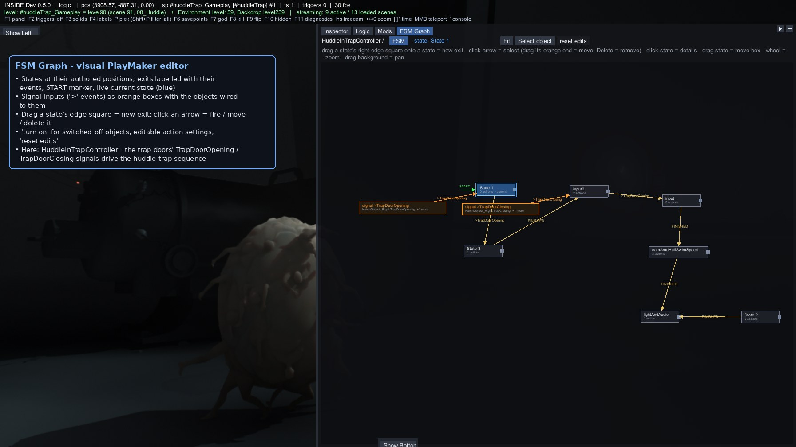</a><br><b>FSM Graph — visual PlayMaker editor</b></td>
<td width="50%" valign="top"><a href="docs/screenshots/explorer.jpg">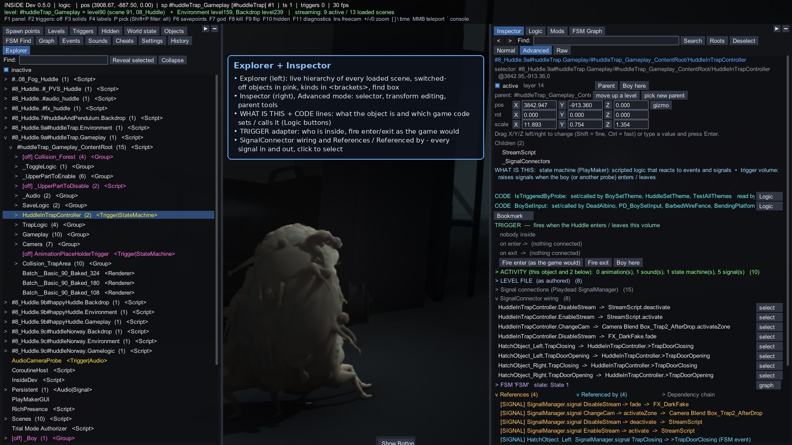</a><br><b>Explorer + Inspector</b></td>
</tr>
<tr>
<td width="50%" valign="top"><a href="docs/screenshots/fsmfind.jpg">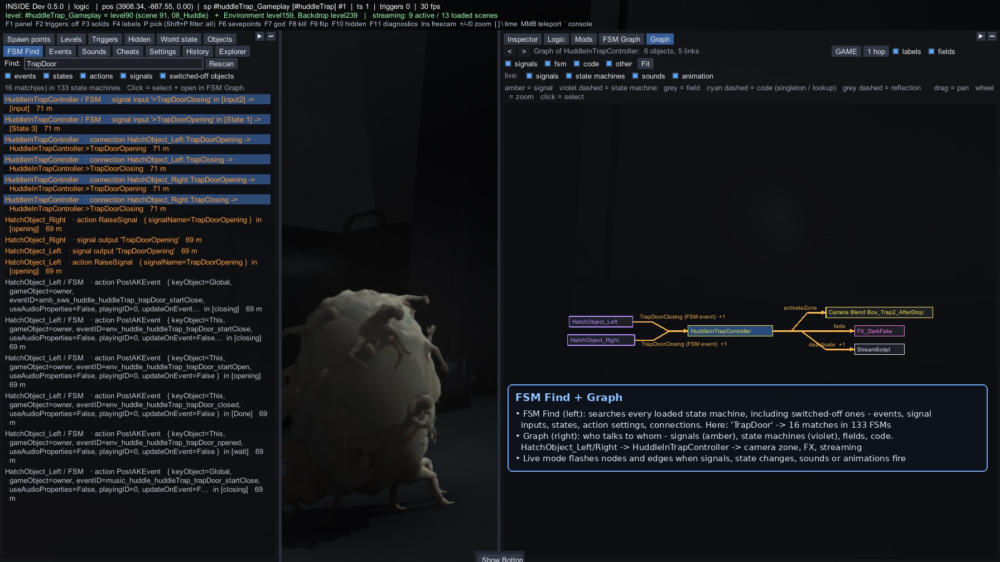</a><br><b>FSM Find + object Graph</b></td>
<td width="50%" valign="top"><a href="docs/screenshots/audio-logic.jpg">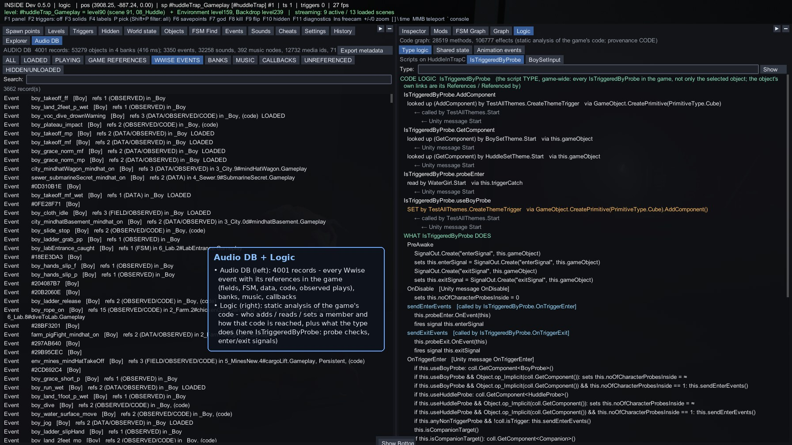</a><br><b>Audio DB + code Logic</b></td>
</tr>
<tr>
<td width="50%" valign="top"><a href="docs/screenshots/overlays.jpg">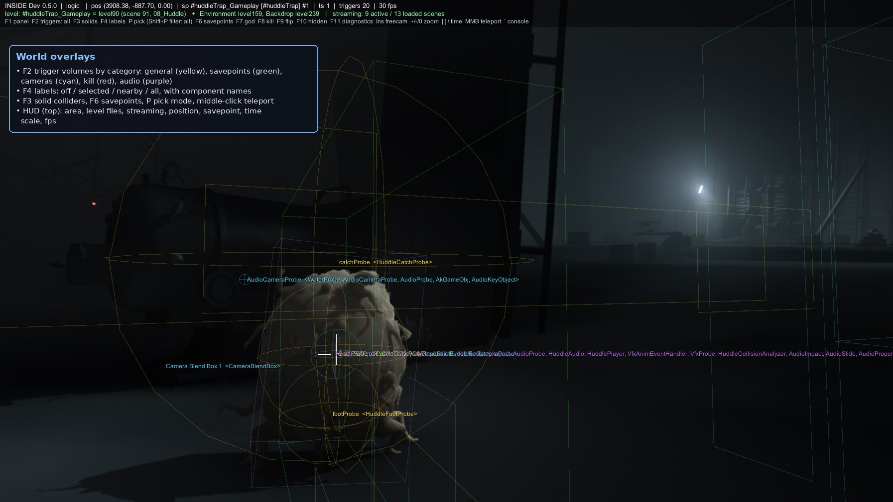</a><br><b>World overlays</b></td>
<td width="50%" valign="top"><a href="docs/screenshots/spawns-mods.jpg">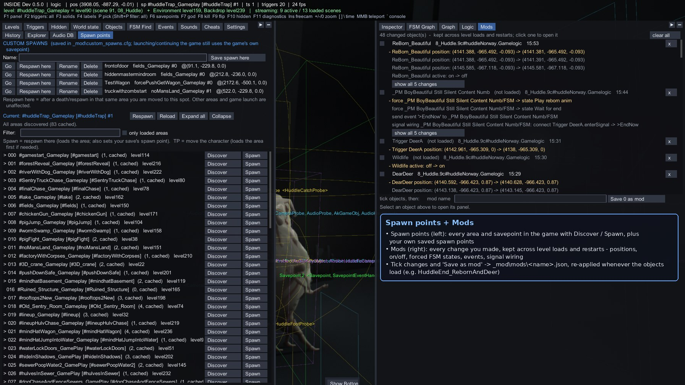</a><br><b>Spawn points + Mods</b></td>
</tr>
<tr>
<td width="50%" valign="top"><a href="docs/screenshots/cheats-memory.jpg">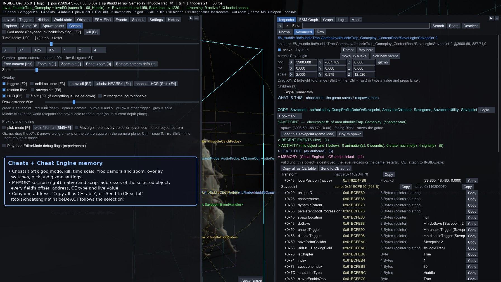</a><br><b>Cheats + Cheat Engine memory</b></td>
<td width="50%" valign="top"><a href="docs/screenshots/settings.jpg">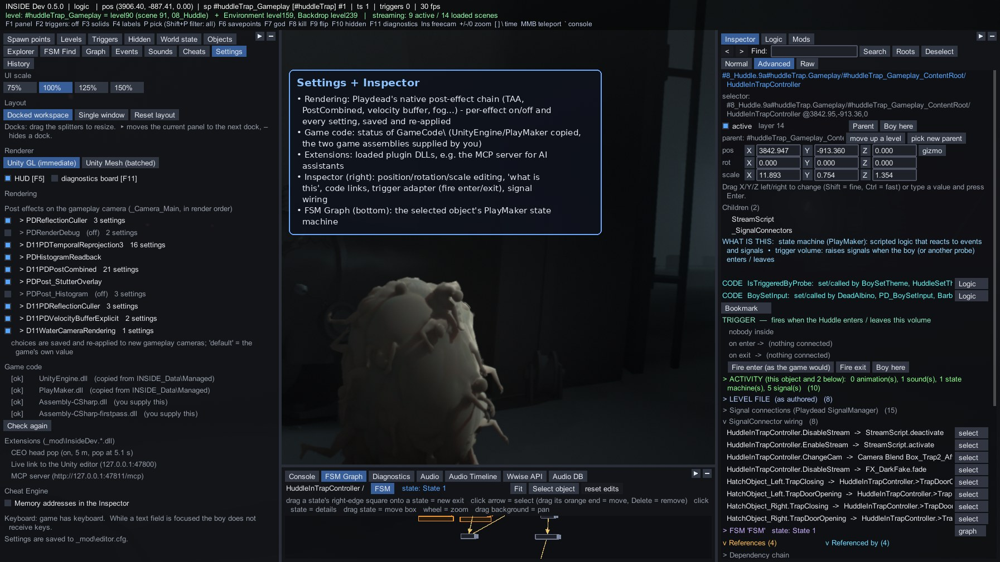</a><br><b>Settings (post effects, game code, extensions)</b></td>
</tr>
<tr>
<td width="50%" valign="top"><a href="docs/screenshots/atlas-hidden.jpg">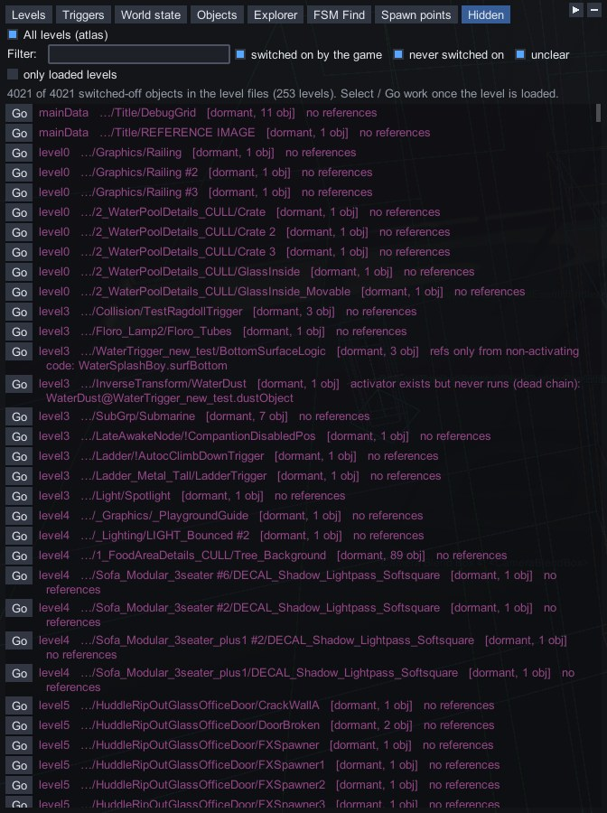</a><br><b>Level atlas: switched-off objects in every level</b></td>
<td width="50%" valign="top"><a href="docs/screenshots/atlas-inspector.jpg">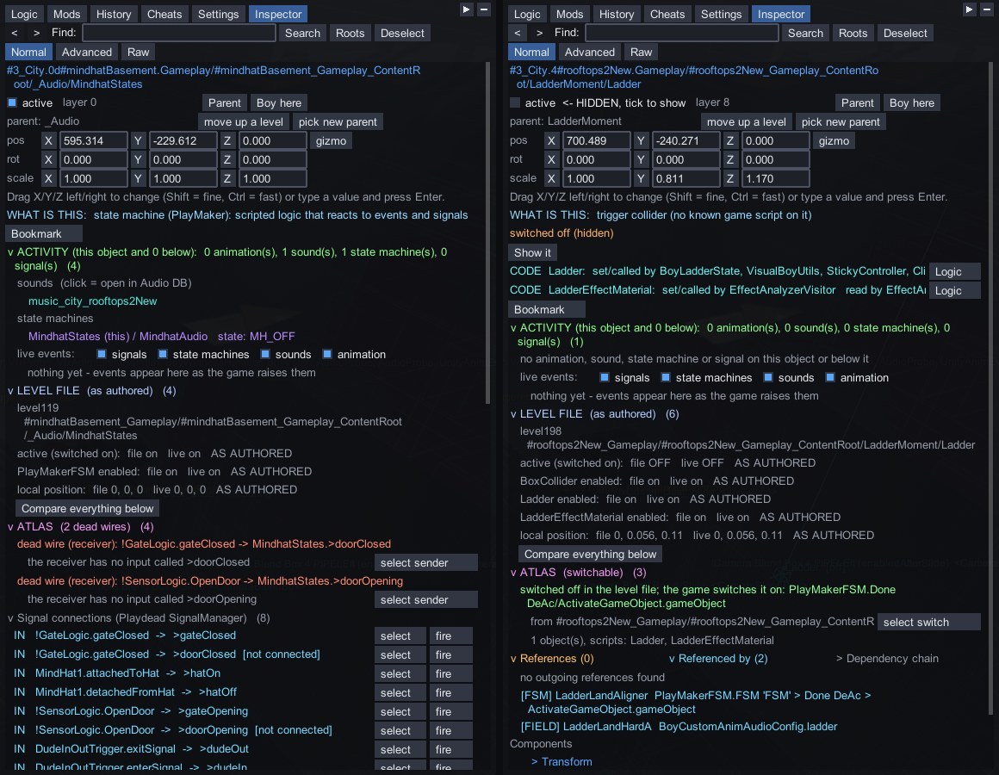</a><br><b>Level atlas in the Inspector: dead wires, who switches an object on</b></td>
</tr>
</table>

## Panels

Docked workspace (left / right / bottom docks, resizable, ▸ moves a panel to the next dock) or a single window;
UI scale 75–150 %; Ctrl+V / Ctrl+C / Ctrl+Backspace in text fields (the boy gets no keys while one has focus).
Global search / command palette **Ctrl+P**, bookmarks. Beyond what the screenshots show:

- **Inspector** — Normal / Advanced / Raw modes; ACTIVITY (animations, sounds, state machines, signals below the
  selection), MATERIALS, LEVEL FILE (object vs. its level file: as authored / changed by you / changed in game),
  ATLAS (switched off in the level file and who switches it on, dead signal wires, dead FSM parts);
  adapters for savepoints, PlayMaker FSMs (fire / force), animation (who plays it, play/stop, pose slider), Animator.
- **FSM Graph** — also: action settings editable (numbers, strings, bools, events, enums, on/off) with per-setting
  undo; connections to switched-off objects link when they wake up; click a hit in FSM Find to open it here; with
  the atlas, states no event in the game leads to and events nothing sends are drawn grey.
- **Levels / Triggers / Hidden / World state / Objects** — level list, nearby triggers, objects the game switches off
  and never on (passive scanner, `_mod\hidden\`; with the atlas also "All levels"), object database search
  (`t:Type`, `k:kind`, hidden/active).
- **Events** — live history of signals, FSM events, sounds and animation clips, with filters.
- **Audio / Sounds / Audio Timeline / Wwise API** — sound files per event (name, codec, length; never extracted),
  "why did this play" call stacks, timeline, audition / trigger original / override, audio rules (mute, nuke,
  replace, force switch/state/RTPC), metadata export (`_mod\export\`).
- **History** — every edit with before/after; undo / redo (Ctrl+Z / Ctrl+Y), revert per property or all.
- **Mods** — `_mod\mods\<name>.json` (selectors + values, never game assets): enable/disable, dry run, validate.
- **Console / Diagnostics** — log console, render and per-subsystem cost diagnostics.

## Keys

F1 panel · F2 trigger overlay (all / general / savepoints / cameras / kill / audio / logic / water / fx /
streaming) · F3 solids · F4 labels
(off / selected / nearby / all) · P pick (Shift+P filter) · F5 HUD · F6 savepoints · F7 god · F8 kill · F9 flip ·
F10 hidden · F11 diagnostics · Insert free camera · + / − / 0 zoom · [ ] \ time scale · middle mouse teleport ·
` console · Ctrl+Z / Ctrl+Y undo / redo · Ctrl+P palette.

## Level atlas

The game only has the levels it has streamed in. The atlas (`data\atlas\*.tsv`, copied to `<game>\_mod\atlas\`)
is a static index of all 253 level files, so the editor knows every level from the first frame:

- Hidden: "All levels (atlas)" lists objects switched off in the level files: switched on later by the game (and by
  what), never switched on by anything, or unclear
- Inspector ATLAS section and FSM Graph: signal wires that never connect, PlayMaker states no event in the game
  leads to, events nothing sends
- Spawn points: savepoints of areas not discovered yet (marked "atlas"; never written to `spawns.cache`)
- Console: `atlas` (status), `atlas find <text>`, `atlas level <n|name>`, `atlas check` (finds every atlas object of
  the loaded levels in play and maps it back); Ctrl+P "Hidden: all levels (atlas)" switches the Hidden list

It holds names, paths, positions and statuses only (no meshes, textures, audio or code). It records the size of
every level file and switches itself off on another game build. How it is made: `tools\atlas\README.md`.

## Cheat Engine

Turn on Settings > Cheat Engine for the Inspector's MEMORY section (see screenshot); "what is at 0x…" resolves an
address to an object/field or a code address to a method. Plugin: load `tools\cheatengine\InsideDev.CT` (or put
`InsideDev.lua` in CE's autorun) — it follows the editor's selection and adds right-click "InsideDev: what is this?" /
"which method?".

## AI assistants (MCP)

`InsideDev.Mcp.dll` is a [Model Context Protocol](https://modelcontextprotocol.io) server that runs inside the game,
so an AI assistant or any MCP client can look at and edit the live game. Tested with Claude; it follows the
standard protocol (versions 2024-11-05 to 2025-11-25), so other MCP clients should work too.

- Endpoint: `http://127.0.0.1:47811/mcp` (Streamable HTTP). It listens on this computer only, never on the network.
- Profiles (tool sets) by path: `/mcp` and `/mcp/dev` = dev (the editor tools below plus `jobs`), `/mcp/play` = play,
  `/mcp/all` = both. The play and world tools come from `InsideDev.Play.dll`; without it the play profile only has
  `screenshot`.
- For clients that start a local program (stdio), point them at `tools\mcp\InsideDev.McpStdio.exe` (needs .NET
  Framework 4.x, built into Windows). It can be connected before the game is started: until INSIDE is running it
  offers only `inside_status`, and it tells the client when the game's tools appear or go away.
  Options: `--profile play|dev|all` (default dev), `--port <n>`, `--url <endpoint>`, `--token <t>`.
- Tools: `game_state`, `screenshot` (returns the image), `show_panel` (open a panel, move it to a dock, resize the
  dock), `find_objects`, `inspect`, `select`, `set_active`, `fsm_graph`, `fsm_find`, `fsm` (send event / force
  state / variables), `signal`, `log`, and `command` (any InsideDev bridge/console command, e.g. `help`, `near 10`,
  `history`, `undo`). Edits are recorded in History.
- Jobs: a tool that runs over many frames holds the control lane as a job; a second one gets `busy` at once. `jobs`
  (dev) lists, awaits and cancels jobs; requests with a progress token get progress over SSE; `notifications/cancelled`
  stops a call. Every result is one JSON object with `ok` first (`error.code`, `hint`, `warnings` when they apply).
- `screenshot` modes: preview (inline image), `marked` (with the ids of `observe`, needs Play) and `full` (file only,
  resource `inside://shots/<file>`; the newest 200 are kept in `_mod\shots\`).
- Plain endpoints for scripts without an MCP client: `POST /cmd` (one console command as the text body, the reply as
  text), `GET /state` (the observe JSON, needs Play), `GET /ping`.
- Restore: after a client has used the server, the game is put back 600 s after the last tool call
  (`mcp.idle_restore_s`) and 60 s after the last session closed (`mcp.restore_on_close_s`); `0` switches either off.
  Restore cancels the running job and undoes what the tools changed (panels opened by `show_panel`; with Play also the
  clock, the input and the world tools' changes).
- Access: `mcp.token` in `<game>\_mod\editor.cfg` requires `Authorization: Bearer <token>`; `mcp.tools` is an allowlist
  (`tool`, `profile:*`, `profile:tool`, `*`; empty = every tool). Changing calls are logged to `_mod\mcp_audit.jsonl`.
- In game: `mcp` (status), `mcp on|off`, `mcp port <n>`, `mcp selftest` then `mcp test` (a real HTTP session
  against the endpoint). Settings > Extensions shows the endpoint.
  Also `mcp jobs`, `mcp providers`, `mcp restore`.

Client setup examples:

```
Claude Code:     claude mcp add --transport http inside http://127.0.0.1:47811/mcp
Claude Desktop:  claude_desktop_config.json ->
                 { "mcpServers": { "inside": { "command": "C:\\path\\to\\InsideDev.McpStdio.exe" } } }   (escape \ as \\)
                 add "args": ["--profile", "play"] for the play profile
Other clients:   HTTP url http://127.0.0.1:47811/mcp, or the stdio command above (optional --port <n>)
```

Ready-made files for Claude Code, Claude Desktop, Cursor, VS Code, Codex and Gemini CLI are in `tools\mcp\clients\`.
Full reference (every endpoint, setting, error code and dev tool): [docs/MCP.md](docs/MCP.md).

## Scene recorder

The scene recorder writes what moves in a scene (transforms, bones, particles, lights, materials, the game camera and
timed events) into a take folder (`scene.srec` plus CSV and JSON sidecars). The recording viewer then holds the frozen
scene at any time of the recording while you fly the free camera, so a take can be scrubbed and looked at from any side.

- Bridge commands (the file bridge or the MCP `command` tool): `srec record start <dir> [key=value ...]`,
  `srec record stop [keep]`, `srec record status`, `srec event <name>`, `srec load <dir> [t=<time>]`, `srec play [speed]`,
  `srec pause`, `srec seek <t|@event>`, `srec step next|back|<s>`, `srec end`, `srec objects [filter]`, `srec probe [n]`,
  `srec status`.
- Nothing records until `srec record start`; `srec end` releases the viewer (the scene stays at the last sample;
  `restore=reload` on `srec load` reloads the savepoint instead).
- Pitfalls: start a recording only after the load has finished (`state` shows the requested savepoint); a minimized
  game window pauses the game; objects spawned at run time replay only in the game session that recorded them.

Reference: [docs/RECORD_REPLAY.md](docs/RECORD_REPLAY.md); design notes: [docs/REPLAY_DESIGN.md](docs/REPLAY_DESIGN.md).

## MultiCam

MultiCam films one scene with many cameras at once. A JSON spec describes the cameras (static, follow, orbit, rails,
director shots, overview, event-driven), cues, slow motion, motion blur and the output; `mcam` runs it in the game and
writes one video (or frame folder) per camera with pose and event logs. Replay mode records the scene once and then
films every camera from the recording, one pass per camera, so every angle shows the same performance.

<table>
<tr>
<td width="50%" valign="top"><a href="docs/screenshots/multicam-layout.jpg">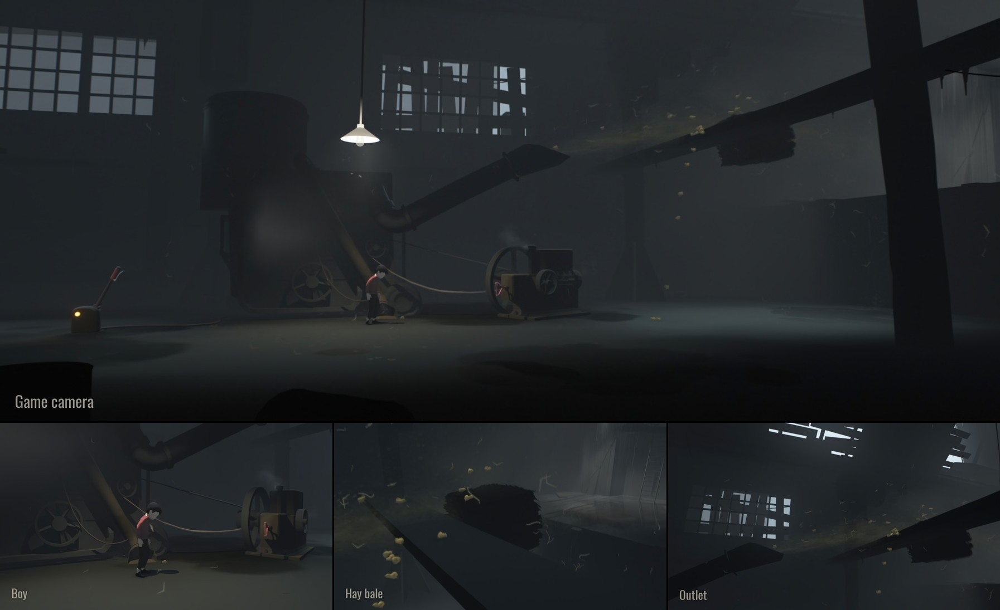</a><br><b>One recorded take, game camera plus three tracking cameras in one layout</b></td>
<td width="50%" valign="top"><a href="docs/screenshots/multicam-game-vs-director.jpg">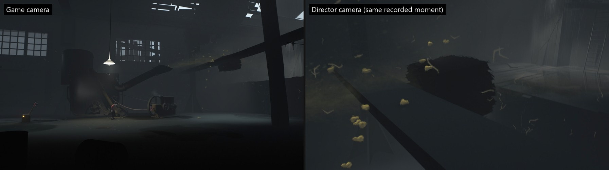</a><br><b>Game camera vs director camera at the same recorded moment</b></td>
</tr>
</table>

- Commands: `mcam check <spec>`, `mcam preview <spec> <out> [t]`, `mcam rehearse <spec> <out>`, `mcam start <spec> <out>`,
  `mcam take <spec> <out>` (record once, then every camera), `mcam replay`, `mcam golden`, `mcam status`, `mcam stop`,
  `mcam abort`, `mcam show <camera> [t]`.
- Helpers: `cam pose x y z yaw pitch [fov] [seconds] [roll]`, `cam json [name]` (prints the current view as a spec
  camera), `cam off`; `clean on|off` (every editor overlay off for clean frames, and back); `hud on|off`;
  `gamma <0..1>|reset`; `seed <n>` (repeatable game randomness).
- A run saves and restores the session (input lock, overlays, vsync, resolution); the game stays frozen after a replay
  run until `ts 1`. Video output (`output.format: "pipe"`) needs `ffmpeg` on PATH (or `output.ffmpeg`);
  `bin\InsideReadback.dll` in `<game>\INSIDE_Data\Plugins\` makes the frame grabs of replay passes faster (without it
  frames are read on the game thread).
- Two example specs are in `specs\`; the offline checker and the compositor are Python tools (see "Python tools and
  guide playbooks").

Reference: [docs/MULTICAM.md](docs/MULTICAM.md) (schema of every spec field, workflows, pitfalls); short guide in Russian:
[docs/MULTICAM_ru.md](docs/MULTICAM_ru.md); design notes: [docs/MULTICAM_DESIGN.md](docs/MULTICAM_DESIGN.md).

## Game audio capture

`acap` writes the game's own sound output (Wwise) to a WAV file with sync markers: on its own (`acap start <name>`,
`acap mark <label>`, `acap stop`) or as part of a recording (`srec record start <dir> audio=on`, a MultiCam replay spec
with `replay.audio.capture: "record"`).

- Default output `audible`: the game sound plays normally while it is captured, at the game's own volume. Nothing is
  muted and the master volume is never raised.
- Output `muted` (opt-in, `acap output muted`, saved as `acap.output` in editor.cfg): for captures while the speakers or
  headphones must stay silent. The master volume is held at 0 and opened only inside a capture window, and only while
  the InsideMuter heartbeat proves every INSIDE audio session is muted in Windows. A capture path is unlocked only by a
  flag file that a passing lab audio stage writes (`acap_suspend_ok.json`, `acap_muteronly_ok.json`), and it should be run
  only with the explicit OK of the person wearing the headphones. `acap output audible` switches back.
- `acap status` and `acap preflight` show the output, the game volume and why a capture would be refused.

**InsideMuter** (`tools\muter\InsideMuter.exe`) is off by default and never starts by itself. While it runs, it **mutes
the sound of every running INSIDE.exe in Windows** (it calls mute on the game's audio sessions every 50 ms and never
changes a volume) and writes a heartbeat file every 250 ms. Copy it to `<game>\_mod\muter\` and start it there before
the game (the core reads `_mod\muter\heartbeat.json` by default), or start it anywhere with `--heartbeat <path>`. It exits
10 s after the last INSIDE.exe has ended. The mute stays on the game's audio session after it exits: unmute INSIDE in the
Windows volume mixer.

Reference: [docs/AUDIO.md](docs/AUDIO.md).

## Debugger

The loader enables Mono's debugger agent on 127.0.0.1:55555, so dnSpy can attach (Debug → Attach → Unity (Connect));
`_mod\nodebugger.flag` turns it off.

## Remote bridge

The file bridge predates the MCP server and still works without it: write `_mod\cmd\in_<anything>.txt` containing
`<id>|<command>`; the answer appears in `_mod\cmd\out.txt`. `help` lists the commands (select, inspect, set,
setactive, fsm, fsmgraph, fsmfind, fsmset, sigs, sigwire, signal, graph, logic, audio, adb, mod, history, undo, mem…,
postfx, gamecode, screenshot, …). Layout from scripts: `ui put <panel> left|right|bottom`,
`ui dock <dock> <size>|on|off`, `ui window x y w h`, `ui docks`, `ui reset`.

## Building

Needs a .NET SDK (Roslyn `csc`) and MinGW-w64 for the loader. The stdio launcher and InsideMuter also need the .NET
Framework 4.x reference assemblies (found automatically on Windows; set `NETFX` elsewhere). `GAME` is the INSIDE folder
with a complete `GameCode\` (see "Game code").

```
GAME=/path/to/INSIDE sh build/build_mod.sh      # bin/InsideDev.dll
GAME=/path/to/INSIDE sh build/build_mcp.sh      # bin/InsideDev.Mcp.dll + tools/mcp/InsideDev.McpStdio.exe
sh build/build_loader.sh                        # bin/version.dll
sh build/build_readback.sh                      # bin/InsideReadback.dll (MinGW-w64 gcc, CC=...)
sh build/build_muter.sh                         # tools/muter/InsideMuter.exe
```

## Folder layout

- `bin\` — prebuilt `version.dll`, `InsideDev.dll`, `InsideDev.Mcp.dll`
- `src\InsideDev\` — the editor; `src\mcp\` — MCP server and stdio launcher; `src\loader\` — the proxy loader
- `src\readback\`: the native readback plugin for MultiCam; `specs\`: example MultiCam specs
- `src\muter\`: InsideMuter
- `build\` — build scripts; `tools\` — MCP launcher, Cheat Engine table, atlas generator; `mods\` — example mods
- `data\atlas\` — the level atlas
- `docs\screenshots\` — the screenshots above
- `docs\`: references and design notes

## Removed features

- Unity editor live link (experimental): mirrored the running game into a Unity 5.0.4 editor project. Removed due
  to severe setup and usability issues.
- Internal resolution slider (INSIDE's native post chain crashes when the camera renders to a texture and the
  engine's render-resolution call is empty in this build) and the DLSS experiment.
- Forced whole-level tour (crashed the game's own animation code); replaced by the passive hidden-item scanner.
- Assembly dumping in the loader and the game-code decode tool (see "Game code").

## License

MIT — see [LICENSE](LICENSE).
